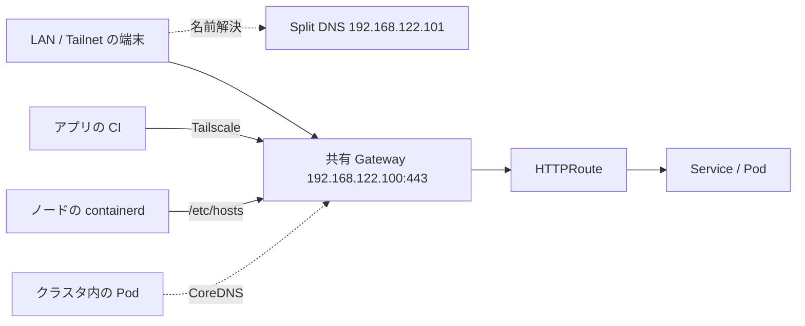

# アクセス経路

Internet に公開している経路はありません。入口は共有 Gateway（`192.168.122.100`）の 1 つで、LAN か Tailscale から届きます。



## URL

すべて `https://<名前>.internal.qroksera.com` です。

| 名前 | 宛先 | 備考 |
|---|---|---|
| `argocd` | ArgoCD | GitHub でログイン |
| `harbor` | Harbor | イメージの push / pull もこの名前 |
| `grafana` | Grafana | |
| `observability` | VictoriaMetrics | VMUI は `/vmui/` |
| `rustfs` | RustFS のコンソール（9001） | |
| `s3` | RustFS の S3（9000） | `pdfs/hitomi/`、`pdfs/videos/`、`home-camera-recordings/` の GET / HEAD / OPTIONS だけ |
| `api-hub` | api-hub | viewer が使う読み取りの経路だけ（下記） |
| `hitomi-upload-viewer` | viewer と media API | |
| `blog` / `cooklog` / `rsshub` | 各アプリ | |
| `nature-remo` | nature-remo | 送信元を制限（下記） |

認証を持つのは ArgoCD、Harbor、Grafana、RustFS のコンソールだけです。ほかのアプリに利用者認証はなく、
「LAN と tailnet にいる端末は信頼する」前提です。そのため、次の 3 つは経路側で絞っています。

- **api-hub**: Gateway に通すのは `/health`、`/s3/list_objects_v2`、`/s3/browser_get_object`、`/s3/browser_open`、`/s3/preview/` だけです。
  更新・削除・Slack・通知の API は、クラスタ内の `api-hub.sandbox.svc:3000` からしか呼べません。
- **s3**: 上の表のパスの読み取りだけを通します。書き込みと bucket の一覧は通しません。
  ブラウザーは api-hub が発行した署名付き URL で PDF や動画を直接取得します。
- **nature-remo**: NGINX Gateway Fabric の AccessPolicy で、LAN（`192.168.10.0/24`）、ノード（`192.168.122.0/24`）、
  Pod と subnet router（`10.244.0.0/16`）、tailnet（`100.64.0.0/10`）以外を 403 にします。
  Gateway の `externalTrafficPolicy: Local` で送信元 IP が保たれることが前提です。前段にプロキシや SNAT を足すときは見直します。

## Gateway

[gateway.yaml](../manifests/access/gateway/gateway.yaml) の listener は 2 つです。

| listener | 用途 |
|---|---|
| `http`（80） | HTTPS へのリダイレクト |
| `https-internal`（443、`*.internal.qroksera.com`） | すべての経路。証明書は wildcard 1 枚 |

Route を置ける namespace は `argocd`・`harbor`・`observability`・`rustfs`・`sandbox` に限っています。
Harbor の Route には、イメージの push のために本文サイズの上限を外す ClientSettingsPolicy を付けています。

## DNS

同じ hosts の一覧を 2 か所に持ちます。名前を足すときは両方に書きます。

| 利用者 | 解決する場所 |
|---|---|
| クラスタ内の Pod | [CoreDNS の ConfigMap](../manifests/access/dns/core/coredns-configmap.yaml) の `hosts` |
| LAN / tailnet の端末 | [Split DNS](../manifests/access/dns/tailscale/manifest.yaml)（`192.168.122.101`、ゾーン `internal.qroksera.com`） |
| ノード（containerd、kubelet） | `/etc/hosts`（Harbor だけ。下記） |

tailnet 側では、`internal.qroksera.com` の Split DNS を `192.168.122.101` に向けています（Tailscale の管理画面の設定）。
LAN の端末で使う場合も、このゾーンを `.101` に転送する設定が要ります。

```bash
dig @192.168.122.101 blog.internal.qroksera.com A +short
```

### Harbor とノードの名前解決

ノードはクラスタ内の DNS を使わないため、`platform-access` の DaemonSet
[harbor-node-hosts](../manifests/access/harbor/node-hosts.yaml) が各ノードの `/etc/hosts` に
`192.168.122.100 harbor.internal.qroksera.com` を書き、60 秒ごとに直します。containerd の設定変更や再起動は要りません。

DaemonSet を消しても `/etc/hosts` の行は残ります。やめるときは `# managed: harbor-node-hosts` の行を全ノードで消します。

## TLS

[cert-manager の設定](../manifests/infrastructure/security/cert-manager/) が、Let's Encrypt の DNS-01（Cloudflare）で
`*.internal.qroksera.com` の証明書を 1 枚発行し、`nginx-gateway/wildcard-internal-tls` に置きます。
公開 CA の証明書なので、端末に独自 CA を入れる必要はありません。
更新は期限の 30 日前に自動で行われ、失敗が続くと `CertificateNotReady` と `EndpointCertificateExpiring` が通知します。

PostgreSQL 用のクラスタ内 CA は別です（[PostgreSQL](postgresql.md#証明書)）。

## Tailnet

- クラスタ内の Connector（[connector.yaml](../manifests/infrastructure/networking/tailscale-operator/connector.yaml)）が
  subnet router として `192.168.122.0/24` を広告します。
- ACL の正本は [tailscale/policy.hujson](../tailscale/policy.hujson) です。
  [tailscale-policy.yml](../.github/workflows/tailscale-policy.yml) が PR で構文と `tests` を検証し、`main` への push で適用します。
  管理画面で直接編集しても、次の適用で上書きされます。

許可している通信は 3 つだけです。

| 送信元 | 宛先 |
|---|---|
| tailnet の利用者 | 共有 Gateway の 80 / 443 |
| tailnet の利用者 | Split DNS の 53 |
| `tag:ci-harbor`（アプリの CI の一時端末） | 共有 Gateway の 443 |

経路を増減するときは `tests` も直します。許可を誤ると、CI から Harbor、端末から Gateway への経路を塞ぎます。
workflow は `policy_file` スコープだけの OAuth クライアントを使います（repository secret の `TS_POLICY_CLIENT_ID` / `TS_POLICY_CLIENT_SECRET`）。

## URL を足す

1. Service の port と、呼び出し元を決める。クラスタ内からしか呼ばないなら、Route は要りません（Service の DNS 名を使う）。
2. `manifests/apps/<app>/access.yaml` に HTTPRoute を 2 つ書く（既存のアプリを写す）。
   - リダイレクト用: `sectionName: http`
   - 本体: `sectionName: https-internal`、hostname は `<名前>.internal.qroksera.com`、backend は **Service の port**
3. CoreDNS と Split DNS の `hosts` に名前を足す。
4. `sandbox` は default-deny なので、Gateway から Pod への NetworkPolicy を足す。こちらは **Pod の待受 port** を書く（[NetworkPolicy](network-policy.md#許可を足す)）。
5. 必要なら Alloy の外形監視に足す（[監視](observability.md#外形監視)）。

listener と証明書は wildcard なので追加は要りません。`sandbox` など上記 5 つ以外の namespace に Route を置く場合だけ、
Gateway の `allowedRoutes` に namespace を足します。

反映後の確認:

```bash
kubectl -n nginx-gateway get gateway,svc,certificate
kubectl -n <namespace> describe httproute <route>     # Accepted / ResolvedRefs
kubectl -n <namespace> get svc,endpointslices
curl --fail https://<名前>.internal.qroksera.com/
```

`NodePort`・`LoadBalancer`・Ingress で公開する変更は CI が拒否します（[policy-check の R-010](validation.md#静的検証)）。
