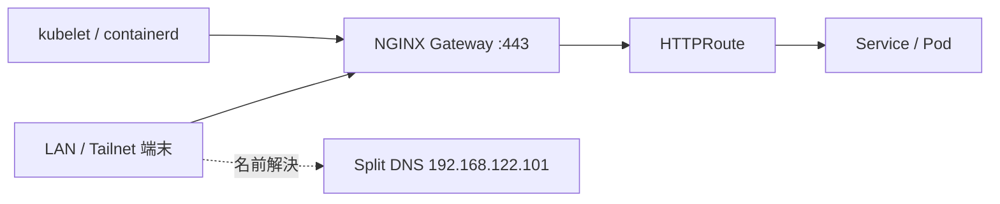

# アクセス経路と公開の追加

アプリの公開経路は各アプリの `apps/<app>/access.yaml`、Gateway・DNS・基盤コンポーネントの経路は [access/](../manifests/access/) です。HTTPRoute・Gateway・DNS の YAML が正本で、
別の台帳は持ちません（公開台帳と専用 checker は 2026-11-16 に撤去）。

## 公開経路のCI検証

[policy-check.py](../automation/scripts/ci/policy-check.py) の R-010 が、各 Application の render 結果から
`NodePort` / `LoadBalancer` / `externalIPs` を持つ Service と、Tailscale 以外の Ingress を拒否します。
許可する Service は同ファイルの `ALLOWLISTED_EXPOSED_SERVICES` に登録します（現在は Split DNS のみ）。
Gateway の LoadBalancer は NGINX Gateway Fabric が生成するため、この検査の対象外です。

ホスト名・DNS 設定・CI 成功だけでは Internet からの到達を遮断できません。
Tailnet ACL、ルーター/NAT、証明書の実値、operator 生成後の Service / Pod は別途確認します。



## 利用する URL

通常の内部 URL は `https://<名前>.internal.qroksera.com` です。
名前は `argocd`、`harbor`、`rustfs`、`blog`、`cooklog`、`api-hub`、`hitomi-upload-viewer`、
`observability`、`rsshub`、`grafana` が宣言されています。
VMUI は `https://observability.internal.qroksera.com/vmui/` です。

Harbor は push・pull・認証を内部 Gateway `192.168.122.100` で完結させます。
コンソールは `https://harbor.internal.qroksera.com` を LAN / Tailscale 経由で利用します。
cloudflared と専用 Secret / Namespace / Application は撤去しました。
旧名 `harbor.qroksera.com` の Route・listener・証明書は 2026-11-16 に撤去し、イメージ名も内部名に統一しました。
Internet向けだった `argocd.qroksera.com`、`rustfs.qroksera.com`、`blog.qroksera.com` の
listener・Route は撤去済みです。現在 Internet 向けの経路はありません。

RustFS の Gateway backend は console の 9001 のみです。S3 の 9000 はクラスタ内で api-hub などが利用します。
console の `/` は GET / HEAD のリダイレクトと POST / Authorization 付き GET の転送を
[HTTPRoute](../manifests/access/rustfs/manifest.yaml) で分岐しています。

## DNS・TLS・外部設定

| 対象 | 宣言元・役割 |
|---|---|
| 共通 Gateway | [gateway.yaml](../manifests/access/gateway/gateway.yaml)、LB `192.168.122.100` |
| クラスタ内 DNS | [CoreDNS](../manifests/access/dns/core/coredns-configmap.yaml) |
| Tailnet 向け DNS | [Split DNS](../manifests/access/dns/tailscale/manifest.yaml)、LB `192.168.122.101` |
| TLS | [cert-manager 設定](../manifests/infrastructure/security/cert-manager/)、DNS-01、`*.internal.qroksera.com` の wildcard 1 枚 |
| ノードの名前解決 | [harbor-node-hosts](../manifests/access/harbor/node-hosts.yaml)、Harbor の hostname を内部 Gateway に固定（ノードはクラスタ内 DNS を使わないため） |

Gateway の証明書 Secret は `nginx-gateway` namespace に置きます。
内部 hostname でも公開 ACME issuer の DNS-01 を使っています。「内部 URL だから独自 CA を端末へ追加する」とは限りません。

Tailnet 側では `192.168.122.0/24` の subnet route 承認、端末での route 受け入れ、
`internal.qroksera.com` の Split DNS を `.101` に向ける設定が必要です。
DNS の UDP/TCP 53、Gateway の TCP 443（HTTP redirect を使うなら 80）の到達性も確認します。
Harbor internal は CoreDNS と Tailscale Split DNS の両方に登録しています。

ArgoCD は GitHub（Dex）でログインします。GitHub OAuth App の callback は ArgoCD の URL と `/api/dex/callback` を一致させます。
Cloudflare 側の旧 Tunnel と argocd・rustfs・blog・harbor の DNS レコードは 2026-11-10 に削除済みです。
Cloudflare 側の設定、Tailnet ACL、OAuth App の設定はこのリポジトリから自動反映されません。

## 新しく到達可能な API を追加する手順

1. 公開範囲（クラスタ内 / LAN・Tailnet / Internet）、hostname、backend Service と port、呼び出し元を決めます。
2. [アプリ配布](app-delivery.md) に従って workload / Service / Secret を追加します。
   クラスタ内 Service DNS のみで利用するなら Gateway / hostname の追加は不要です。
3. `apps/<app>/access.yaml` に HTTPRoute を追加し、同じ Kustomization に登録します。
   `parentRefs.sectionName` は `https-internal`（redirect は `http`）、hostname は `<名前>.internal.qroksera.com`、
   backend は **Service port** を指定します。listener と証明書は wildcard のため追加不要です。
   `sandbox` 以外の namespace から公開する場合だけ、listener の `allowedRoutes` に namespace を追加します。
4. 必要な CoreDNS / Split DNS の hosts を更新します。
   ConfigMap の変更時は Pod template も変更し、新しい設定を読み込ませます。
5. [NetworkPolicy](network-policy.md) の受信先・送信元と **Pod の待受 port** を確認し、必要な許可を追加します。
6. 静的検証後、Secret / workload の準備、公開経路の同期、クライアントからの実操作を順に確認します。

Service が 80 → 8080 なら HTTPRoute は 80、NetworkPolicy は 8080 です。
既存 HTTPRoute の PathPrefix 内で API のパスだけを追加する場合、接続先・port・公開範囲が変わらなければ
新しい Route は通常不要です。認証・認可はアプリ側で実装します。

## 反映後の確認

```bash
kubectl -n argocd get applications
kubectl -n nginx-gateway get gateway,svc,certificate
kubectl -n <namespace> describe httproute <route-name>
kubectl -n <namespace> get svc,endpointslices
```

Gateway の Programmed、HTTPRoute の Accepted / ResolvedRefs、Certificate の Ready を確認します。
利用端末で DNS と HTTPS、ログイン後の主要操作を確認し、通信制限を追加した場合は拒否される経路も実測します。
初回公開や依存変更の順序を、別 Application の wave だけに依存させないでください。

## Harbor の内部経路

`platform-access` が kube-system の `harbor-node-hosts` DaemonSet を管理します。
ノードの `/etc/hosts` のみをファイルマウントし、Harbor の hostname（旧名を含む）の競合を除去して
`192.168.122.100` に固定します。他のホスト名は保持し、60 秒ごとに再調整します。
containerd の設定・再起動、hostNetwork、privileged は不要です。
Pod DNS は CoreDNS、ノードはこの DaemonSet を使います。

イメージ名は `harbor.internal.qroksera.com/sandbox/...` です。旧名 `harbor.qroksera.com` では pull できません。
Harbor の externalURL / EXT_ENDPOINT は内部 hostname に統一し、token realm も内部へ向けます。
証明書検証は維持します。Cloudflare DNS-01 用の Secret は証明書更新に必要なので残します。

再構築時は DaemonSet の全ノード Ready と両 hostname の内部 HTTPS 到達を確認し、
Harbor・Secret・Split DNS を同期して認証付き pull を確認します。
App-of-Apps の sync wave だけで既存 Application の同期完了順を保証しないでください。

DaemonSet を削除しても `/etc/hosts` のエントリは残ります。
固定先を廃止する場合は DaemonSet を停止し、全ノードで `# managed: harbor-node-hosts` の行を除去します。
