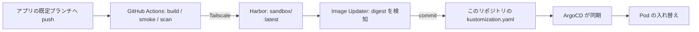

# アプリ配布

アプリのリポジトリに push してから、クラスタの Pod が入れ替わるまでの流れです。



push からの所要時間は、CI の時間に加えて、Image Updater の確認間隔（2 分）と ArgoCD の確認間隔（5 分）の分だけかかります。

## CI: build と公開

各アプリのリポジトリは、自分のテストの job と、共通 workflow の呼び出しだけを持ちます。

```yaml
  publish:
    needs: test
    uses: home-lab-ksera/home-lab-k8s/.github/workflows/publish-harbor.yml@main
    permissions:
      contents: read
      id-token: write
    secrets: inherit
    with:
      image_name: my-app        # Harbor の sandbox/<image_name>
      # dockerfile: apps/x/Dockerfile   context: .   test_target: test   build_args: KEY=VALUE
      # smoke_command: bash scripts/smoke.sh my-app:ci
```

[publish-harbor.yml](../.github/workflows/publish-harbor.yml) がすること:

1. buildx で build する（GitHub Actions のキャッシュを使用）。
2. smoke テストと Trivy のスキャンを実行する（Trivy は報告だけで、失敗にはしません）。
3. 既定ブランチへの push のときだけ、Tailscale に OIDC で接続して Harbor に push する。PR と手動実行は 2 まで。
4. `build-<run-id>-<attempt>-<sha>` タグで push し、その commit が既定ブランチの先頭と一致するときだけ `latest` を付け替える。
5. push したイメージの digest が、build したものと一致することを確かめる。

Rust のリポジトリは [rust-verify.yml](../.github/workflows/rust-verify.yml) も呼びます。fmt、clippy、cargo-audit のどれかに指摘があると失敗し、
publish はその成功を待ちます。ビルドに含まれない crate への指摘は、理由を添えて各リポジトリの `.cargo/audit.toml` で除外します。

共通 workflow は `@main` で参照されるため、変更は全アプリの次の publish に効きます。変えたら、まず 1 つのリポジトリで公開まで確認します。

### CI の認証情報

| Secret | 内容 |
|---|---|
| `TS_OAUTH_CLIENT_ID`、`TS_AUDIENCE` | Tailscale の trust credential（GitHub の OIDC を信頼し、`tag:ci-harbor` の一時端末を作る） |
| `HARBOR_USERNAME`、`HARBOR_PASSWORD` | Harbor の Robot Account（`sandbox` の push / pull） |

public のリポジトリは Organization の Secret を使います。private のリポジトリには同じ 4 つを repository の Secret として登録します。

Tailscale の trust credential は、対象の Organization とリポジトリ、`push` イベント、ブランチ（`refs/heads/ma*`）を条件にしています。
このパターンは `main` と `master` のほか、`ma` で始まる他のブランチにも一致します。
CI の一時端末が届くのは Harbor（共有 Gateway の 443）だけです（[Tailnet](access.md#tailnet)）。

## Image Updater: digest の書き戻し

[sandbox-images.yaml](../manifests/platform/ci-cd/image-updater/sandbox-images.yaml) に登録した 11 のイメージについて、
`latest` の digest が変わると、このリポジトリの `manifests/apps/<app>/kustomization.yaml` の `images` を書き換えて `main` に commit します。

- commit は Deploy Key で直接 push され、`[skip ci]` が付きます。
- マニフェストのイメージ名は `harbor.internal.qroksera.com/sandbox/<image>:latest` のままで、Kustomize が digest を付けます。
  実際に動くイメージは `kustomize build manifests/apps/<app>` の出力で確認します。
- digest が Git に残るため、いつ何を配ったかは履歴で分かります。

入れ替わり方は workload の種類で違います。

| 種類 | 入れ替わり |
|---|---|
| Deployment | すぐ。Recreate のもの（api-hub、media-worker、hitomi-outbox など）は短く止まる |
| StatefulSet（home-camera） | 古い Pod が止まってから新しい Pod。録画中なら書きかけのファイルが残ることがある |
| CronJob | 次に作られる Job から。実行中の Job は古いイメージのまま |

同じ Application の中の workload は一緒に更新されます。別の Application との同時切り替えは保証されません。
API を変えるときは、古い呼び出し側でも動く形で先に配ります。

## イメージを戻す

`kustomization.yaml` の digest を revert しても、Image Updater が `latest` の digest に書き戻します。戻すには `latest` 自体を変えます。

1. **通常**: アプリのリポジトリで原因の commit を revert して push する。CI が新しい `latest` を公開します。
2. **急ぐとき**: Harbor の UI で、`latest` タグを今の artifact から外し、戻したい artifact に付ける。
   戻せるのは Harbor に残っている直近 5 件までです（[Harbor](storage.md#harbor)）。

## アプリを追加する

1. **マニフェスト**: `manifests/apps/<app>/` に `manifest.yaml`、`kustomization.yaml`（`images` に `newTag: latest` のエントリ）、
   URL が要るなら `access.yaml` を作る。既存のアプリを写すのが早いです。
   - イメージは digest 固定になるので、`imagePullPolicy: IfNotPresent` を明示します（`:latest` は既定が Always のため）。
   - `resources` の requests と memory の limit を書きます。
2. **Application**: `manifests/bootstrap/applications/user-apps/<app>-app.yaml` を作り（Project `apps`、wave 12、`targetRevision: HEAD`）、
   同じディレクトリの `kustomization.yaml` に足す。
3. **通信**: `sandbox` は default-deny です。必要な [NetworkPolicy](network-policy.md#許可を足す) を足す。
4. **Secret / DB**: 必要なら [ExternalSecret](secrets.md)、[DB](postgresql.md#アプリから使う) を用意する。
5. **URL**: [URL を足す](access.md#url-を足す) の手順で Route と DNS を足す。
6. **自動更新**: `sandbox-images.yaml` に Application 名とイメージを登録する。登録しないと digest は更新されません。
7. **CI**: アプリのリポジトリに呼び出し側の workflow を置く（下記）。
8. [GitOps の一覧](gitops.md#application-一覧) と [アプリ一覧](apps.md) を直す。

最初のイメージが Harbor にない状態で 1〜2 をマージすると、Pod は ImagePullBackOff になります。先に CI でイメージを公開しておきます。

### 呼び出し側の workflow を作る

```bash
make add-runner REPO=my-app            # 所有者は既定で home-lab-ksera
make add-runner REPO=owner/my-app
```

`gh` で認証済みである必要があります。スクリプトは GitHub の API でリポジトリの公開範囲と既定ブランチを調べ、次を行います。

- `automation/scripts/github-actions/.github/workflows/build-and-push-<repo>.yml` に workflow を生成する（Git 管理外）。
  中身を確認し、テストの job を足して、アプリのリポジトリの `.github/workflows/` に commit します。
- private のリポジトリなら、上の 4 つの Secret を登録する。値は環境変数から読み、なければ端末で非表示入力します。
  値をコマンドの引数に書きません。

```bash
make add-runner REPO=my-app RUNNER_ARGS=--force             # 生成済みのファイルを上書き
make add-runner REPO=my-app RUNNER_ARGS=--non-interactive   # 4 つの値が環境変数にあるとき
```

イメージ名はリポジトリ名を小文字にしたもので、ルートの Dockerfile を build する前提です。違う場合は生成後に `with:` を直します。
`make add-runners-all` は `settings.toml` の `arc_repositories` にあるリポジトリをまとめて処理します。

## 確認

```bash
kubectl -n argocd logs deployment/argocd-image-updater-controller --tail=50
kubectl -n sandbox get pods -o jsonpath='{range .items[*]}{.metadata.name}{"\t"}{.status.containerStatuses[*].imageID}{"\n"}{end}'
git log --oneline --grep='automatic update' | head
```
