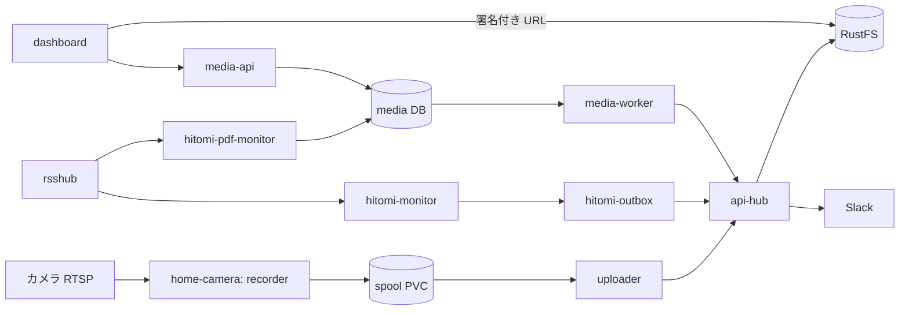

# アプリ一覧

アプリはすべて `sandbox` namespace にあり、1 アプリが 1 つの ArgoCD Application です。
ソースは `home-lab-ksera` の各リポジトリ、マニフェストは [manifests/apps/](../manifests/apps/) にあります。
追加と配布の手順は [アプリ配布](app-delivery.md) です。

| Application | リポジトリ | 役割 | URL |
|---|---|---|---|
| api-hub | api-hub | S3 と Slack への窓口。通知キューを持つ | `api-hub`（読み取りのみ） |
| dashboard | dashboard | 個人用の Web UI（メディア・カメラ録画・失敗管理・リモコン） | `dashboard`（`/media/` は media-api） |
| hitomi | hitomi | 定期的に収集し、新着を通知に回す | なし |
| hitomi-pdf | hitomi-pdf-batch | メディア（PDF・動画）の取得とカタログ | `dashboard` の `/media/` |
| home-camera | home-camera | カメラの録画と S3 への送信、動きの解析と朝の通知 | なし |
| market-collector | market-collector | S&P500・日経225 の全構成銘柄の終値と出来高、組み入れ・除外を DB に保存し、MVP 該当銘柄を通知 | なし |
| nature-remo | nature-remo | 家電リモコンの API（Nature Remo の Local API）。画面は dashboard の「リモコン」 | `dashboard` の `/remo/api/` |
| oci-always-free | （Git 管理外） | OCI Always Free 枠の確保を再試行 | なし |
| rsshub | RSSHub-private | RSS の生成 | `rsshub` |
| blog | blog | 静的サイト | `blog` |
| cooklog | cookLog | 静的サイトと、Slack 連携の worker | `cooklog` |



S3 と Slack に直接つなぐのは api-hub だけです。ほかのアプリは `http://api-hub.sandbox.svc:3000` を呼びます。

## api-hub

API と設定は [api-hub の README](https://github.com/home-lab-ksera/api-hub#readme)、通知キューの詳細は [notification-state.md](https://github.com/home-lab-ksera/api-hub/blob/main/docs/notification-state.md) にあります。

- Deployment 1 つ（`--serve`）で、HTTP API と通知の配送を同じプロセスで動かします。replica 1 / Recreate のため、更新時に短い停止があります。
  呼び出し側は再試行します。
- 通知は DB（`api_hub`）のキューに永続化してから Slack へ送ります。API の 202 は「受け付けた」の意味で、送信完了ではありません。
- 終了時は新しい処理を始めず、進行中の HTTP と通知を待ってから止まります（終了猶予 90 秒）。
- Slack への送信結果が分からないもの（uncertain）は自動では再送しません。Slack を確認してから手で再試行します。
- migration は PreSync の Job（`--migrate`）で、同期のたびに先に実行されます。

## hitomi

収集と通知の規則、失敗の管理 CLI は [hitomi の docs/state.md](https://github.com/home-lab-ksera/hitomi/blob/main/docs/state.md) にあります。

| workload | 内容 |
|---|---|
| CronJob `hitomi-monitor` | JST 02:55 から 4 時間ごと。収集して新着を DB に記録 |
| Deployment `hitomi-outbox` | `--dispatch`。新着を api-hub の通知に渡す |

- 収集には Selenium が要ります。CronJob の native sidecar（`restartPolicy: Always` の init container）として、収集のときだけ起動します。
  Grid の準備ができるまで本体は始まらず、本体が終わると sidecar も止まります。本体は `127.0.0.1:4444` に接続します。
- Job は同時実行なし、再試行なし、上限 2 時間です。失敗した項目は DB の履歴をもとに次回以降に再試行されます。
- 新着の判定は DB の履歴で行います。RSS の取得に失敗しても、すでに記録済みの未処理分は処理します。
- outbox の役目は api-hub が受け付けるまでです。Slack に届いたかは api-hub 側で見ます。

## hitomi-pdf（media）

実行モード、エラーごとの再試行、失敗の管理は [hitomi-pdf-batch の docs/stateful-media.md](https://github.com/home-lab-ksera/hitomi-pdf-batch/blob/main/docs/stateful-media.md) にあります。

| workload | 内容 |
|---|---|
| CronJob `hitomi-pdf-monitor` | JST 00:50 と 07:50。`--plan` で取得する項目を DB に登録 |
| Deployment `media-worker` | `--worker`。登録された項目を取得し、api-hub 経由で S3 に置く |
| Deployment `media-api` | `--serve`。カタログの API。dashboard が使う |
| CronJob `media-reconcile` | 毎時 20 分。期限切れや古い未完了の整理（S3 には接続しない） |
| CronJob `media-verify-objects` | 毎日 04:40 JST。カタログにあるオブジェクトが S3 に実在するか確認 |

- 取得は 1 項目ずつ、lease と再試行（最大 8 回）で管理します。失敗を一括で取り直すことはしません。
- worker の一時領域はノードのディスク上の emptyDir（6GiB）です。1 ファイルの上限は 5GiB で、ノードの空きを 4GiB 残せないときは中断して再試行に回します。
  worker は replica 1 / Recreate を保ちます（一時領域を共有しないため）。
- PDF と動画は、ブラウザーが署名付き URL で S3 から直接取得します。URL は api-hub が発行します。
- S3 のオブジェクトは 30 日で消えます（[RustFS](storage.md#30-日で消す)）。カタログ側の期限整理は `media-reconcile` が行います。
- 既存の S3 オブジェクトをカタログに登録し直す `--import` は、通常の同期では実行しません。
  必要なときだけ [明示的な Job](../automation/examples/media-import/README.md) で実行します。

## dashboard

画面の構成と開発の手順は [dashboard の README](https://github.com/home-lab-ksera/dashboard#readme) にあります。

- Deployment 1 つ（busybox httpd）で静的ファイルを配るだけです。API は持ちません。
- `https://dashboard.internal.qroksera.com` の `/media/` は media-api へ、それ以外は dashboard へ振り分けます（[access.yaml](../manifests/apps/dashboard/access.yaml)）。
- api-hub（署名付き URL の発行と S3 の一覧）は別の Origin で呼びます。api-hub と RustFS の CORS は dashboard の Origin だけを許可します。
- 外部の CDN に依存しません。アセットはすべてイメージに含めます。

## home-camera

録画ファイルの扱いと隔離の手順は [home-camera の docs/state.md](https://github.com/home-lab-ksera/home-camera/blob/main/docs/state.md) にあります。

StatefulSet 1 つに、recorder（`--record`）と uploader（`--upload`）の 2 コンテナがあります。DB は使いません。

- recorder は RTSP を 1 時間ごとのファイルに分けて spool の PVC（NFS、100GiB）に書きます。録画する時間帯はアプリ側の設定です。
- uploader は完成したファイルを api-hub 経由で S3 に送り、S3 側のサイズを確かめてから spool から消します。
  送信後に spool 上で「動きがあった区間」を解析し、結果を録画の横に `.motion.json` として置きます（1時間の録画で数分）。
- CronJob `home-camera-summary`（毎日 09:30 JST、`--summary`）が、前の晩の動きの区間を文字だけで Slack に送ります。画像は送りません。
- spool の上限は 80GiB です。空きが足りなくなると、未送信のファイルは消さずに録画を止めます。
- 録画中に Pod やホストが止まると、書きかけのファイル（moov atom なし）が残り、`CameraPartialSegment` が出ます。
  対処は上の docs/state.md の隔離手順に従います。壊れたファイルや manifest を推測で作り直しません。

## market-collector

取得の規則と表の定義は [market-collector の README](https://github.com/home-lab-ksera/market-collector#readme) にあります。

| リソース | 内容 |
|---|---|
| CronJob `market-collector-sp500` | JST 07:30、火〜土（米国の引け後） |
| CronJob `market-collector-nikkei225` | JST 17:30、月〜金（東証の引け後） |

どちらも、構成銘柄の一覧を取り直して DB `market` の `index_memberships` と突き合わせ、有効な全銘柄の日足を `daily_prices` に upsert します。

- 構成銘柄は S&P500 が英語版 Wikipedia の一覧、日経225 が日経の公開 CSV（月末時点のウエート一覧）です。日経の CSV は更新が月 1 回のことがあり、入れ替えの反映が遅れることがあります。
- 組み入れ・除外は、一覧に現れた日・消えた日（JST）を `added_on` / `removed_on` に記録します。正式な実施日ではありません。除外した銘柄の日足は消しません。
- 一覧の件数が想定（S&P500 は 490〜520、日経225 は 220〜230）を外れたら、取得元の形が変わったとみなし、同期も価格の取得もせずに失敗します。
- 日足の無い銘柄（初回と組み入れ直後）は過去 10 年分を取ります。それ以外は毎回直近 1 か月を取り直すため、失敗した回の分は次の回で埋まります。
- 価格は Yahoo Finance の非公式 API です。1 銘柄でも取れないと Job が失敗し、`KubernetesCronJobFailed` が通知します。ログの `failed:` の行に銘柄が出ます。
- 最後に直近 15 営業日の MVP 条件で銘柄を選び、該当があれば api-hub 経由で Slack（`C09DNN3S76D`）に通知します。
  条件は 15 日のうち 12 日以上上昇・15 日目の出来高が 1 日目の 1.25 倍以上・株価が 16 営業日前の終値から +20% 以上の 3 つすべてです。
  指数と取引日ごとに 1 通で、条件を満たしている間は毎日送ります。該当が無い日は送りません。
- Grafana のダッシュボード「05 株価 / 銘柄」で、銘柄ごとの終値・出来高・MVP 指標を見られます。
- 通信は外部への HTTPS と api-hub:3000 だけです（`allow-market-collector-https`、`allow-api-hub-clients-egress`）。

```bash
kubectl -n sandbox create job "market-collector-manual-$(date +%Y%m%d%H%M%S)" --from=cronjob/market-collector-sp500
# 通知の経路（api-hub → Slack）だけを確かめる。テストの 1 通を送って終わる
kubectl -n sandbox create job "market-collector-notify-test-$(date +%Y%m%d%H%M%S)" --from=cronjob/market-collector-sp500 --dry-run=client -o json \
  | jq '.spec.template.spec.containers[0].env += [{"name": "NOTIFY_TEST", "value": "1"}]' | kubectl create -f -
kubectl -n sandbox logs -f job/<作った Job の名前>
```

## nature-remo

アプリの使い方とバックアップは [nature-remo の README](https://github.com/home-lab-ksera/nature-remo#readme) にあります。

Nature のクラウドが使えないときでも家電を操作できるようにする API サーバーです。保存した赤外線信号を、LAN 内の Remo 本体に Local API で送ります。
画面は dashboard の「リモコン」（`/remo`）で、Gateway が `dashboard.internal.qroksera.com/remo/api/` を nature-remo の `/api/` に書き換えて転送します（HTTPRoute `nature-remo-dashboard`）。
クラウドの障害時に使うため、dashboard と nature-remo のどちらが止まってもリモコンは使えません。

- 対象の Remo は [kustomization.yaml](../manifests/apps/nature-remo/kustomization.yaml) の `REMO_DEVICES` と、
  [access.yaml](../manifests/apps/nature-remo/access.yaml) の NetworkPolicy（`192.168.10.2:80`）の 2 か所に書きます。
  Remo の IP はルーターの DHCP 予約で固定します。`REMO_DEVICES` の `id` を変えると、登録済みのボタンと対応が取れなくなります。
- アプリにログインはありません。許可したネットワークからだけ届くよう、Gateway で送信元を絞っています（[アクセス経路](access.md#url)）。
- 信号は NFS の PVC の `buttons.json` に保存します。書き込みを 1 つに保つため replica 1 / Recreate です。
  PVC は ArgoCD が消さない設定（`Prune=false,Delete=false`）にしています。
- 送信は自動で再送しません。失敗と表示されても家電が動いていることがあるため、実物を確認します。
- エアコンなどの現在の状態は分かりません。登録した信号を送るだけです。

## oci-always-free

OCI の Always Free 枠を確保する再試行 Job です。ソースは `ksera524/oci-always-free`（Git 管理外。運用は同ディレクトリの CONTAINERS.md）。
A1 以外のリソースは作成済みで、残りは A1 の VM 2 台の空き待ちです。

- 状態（作成記録・ロック・DB パスワード）は NFS の PVC `oci-always-free-state` にあります。消えると OCI のリソースを二重に作るおそれがあるため、
  PVC は ArgoCD が消さない設定（`Prune=false,Delete=false`）です。
- Secret `oci-always-free-credentials`（OCI の署名鍵・config・SSH 公開鍵）と `oci-always-free-slack` は手で作ったもので、Git と ESC にはありません。
  クラスタを作り直したら作り直しが必要です。
- 通信は OCI の API と Slack への HTTPS だけです（`allow-oci-always-free-https`）。
- Job は 120 秒ごとに再試行し、A1 2 台を含む全リソースがそろったら Slack に通知して完了します。
  Oracle が自動で止めた Autonomous DB（7 日間操作なし）は、Job が起動し直します。
- 終了コード 78 は人の確認が要る安全停止で、Job が失敗になります（Application が Degraded になり通知が出ます）。
  原因はログの `Safety stop:` の行にあります。直したら ArgoCD で Job を作り直します（Replace で再作成されます）。
- イメージは手元で build して Harbor に push し、[kustomization.yaml](../manifests/apps/oci-always-free/kustomization.yaml) の digest を書き換えます。
  Image Updater の対象外です。

```bash
kubectl -n sandbox logs -f job/oci-always-free
kubectl -n sandbox exec job/oci-always-free -- cat /data/all/retry-status.json
```

## rsshub

自作のルートの一覧は [RSSHub-private の CUSTOM_RSS.md](https://github.com/home-lab-ksera/RSSHub-private/blob/master/CUSTOM_RSS.md) にあります。

- Deployment `rsshub-private`（Service は `rsshub:1200`）と、キャッシュ用の `rsshub-redis` です。
- Redis は永続化なし、128MB で古いものから捨てる設定です。再起動するとキャッシュは空になります。
- Chromium を使う route のために、256Mi の `/dev/shm` を割り当てています。
- hitomi と hitomi-pdf は、内部 URL（`https://rsshub.internal.qroksera.com`）でフィードを取得します。

## blog / cooklog

Slack からのレシピ取り込みは [cookLog の docs/slack-import.md](https://github.com/home-lab-ksera/cookLog/blob/main/docs/slack-import.md) にあります。

- どちらも Eleventy で作った静的サイトを配信する Deployment です。
- `cooklog-slack` は Slack と連携する worker で、キューを NFS の PVC に持ちます。
  イメージは `latest` ではなく特定の `build-*` タグを指しており、Image Updater の対象外です。更新するときはマニフェストのタグを手で書き換えます。

## DB を復元したあと

[DB の復元](postgresql.md#復元) をしたら、次を確認します。

1. api-hub、hitomi、media の migration Job が成功している。
2. 各キューの状態を Grafana か VMUI で見る（[キューの監視](observability.md#アプリのキュー)）。
3. 通知の sending / uncertain を一括で pending に戻したり、全件を再送したりしない。DB が巻き戻った分の重複通知は許容します。
4. home-camera の spool と S3 は DB と無関係なので、触りません。
