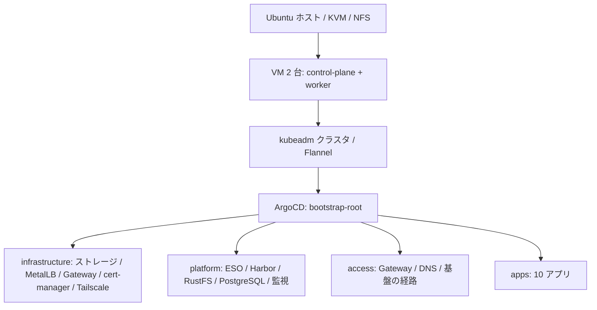

# 全体構成

1 台の Ubuntu ホスト上に libvirt の VM を 2 台立て、kubeadm で作った Kubernetes クラスタを ArgoCD で管理しています。
VM と OS の準備は Terraform とスクリプト、クラスタ内のリソースはすべて GitOps です。

## ノードとネットワーク

| 対象 | 値 |
|---|---|
| ホスト | `ksera-T100`、LAN `192.168.10.11`、VM 側 `192.168.122.1`（libvirt の default ネットワーク） |
| control-plane | `k8s-control-plane` / `192.168.122.10`。taint なしでアプリの Pod も受ける |
| worker | `k8s-worker2` / `192.168.122.12`。local-path の PV はこのノードに固定される |
| Pod / Service CIDR | `10.244.0.0/16` / `10.96.0.0/12` |
| MetalLB（L2） | `192.168.122.100-192.168.122.150` |
| 共有 Gateway | `192.168.122.100`（HTTP 80 / HTTPS 443） |
| Split DNS | `192.168.122.101`（`internal.qroksera.com`） |
| NFS | `192.168.122.1:/mnt/k8s-storage/nfs-share` |

CNI は Flannel で、NetworkPolicy は別の DaemonSet（kube-network-policies）が実行します。
VM のサイズやノード個別の設定は [ホストとノード](nodes.md) を参照してください。

## 入口

Internet に公開している経路はありません。利用者は LAN または Tailscale から共有 Gateway に届きます。

- Tailnet の端末は、クラスタ内の subnet router が広告する `192.168.122.0/24` を経由します。
- アプリリポジトリの CI（GitHub-hosted runner）は、Tailscale で Harbor にだけ届きます。
- すべての URL は `https://<名前>.internal.qroksera.com` で、wildcard 証明書 1 枚を使います。

詳細は [アクセス経路](access.md) です。

## コンポーネント

| 領域 | 構成 |
|---|---|
| GitOps | ArgoCD（本体と設定も自己管理）、GitHub ログイン（Dex）、Image Updater |
| 認証情報 | External Secrets Operator → Pulumi ESC |
| ネットワーク | MetalLB、NGINX Gateway Fabric、cert-manager（Let's Encrypt DNS-01 / Cloudflare）、Tailscale Operator、kube-network-policies |
| ストレージ | local-path（ノードのディスク）、NFS subdir provisioner（ホストの HDD） |
| レジストリ | Harbor（自作イメージの保管。Trivy は無効） |
| データ | RustFS（S3 互換）、PostgreSQL（単一の StatefulSet） |
| 監視 | VictoriaMetrics、vmalert、Alertmanager、kube-state-metrics、metrics-server、Grafana、Loki、Alloy |
| 補助 | Reloader（Secret / ConfigMap の変更で Pod を再起動） |

アプリは api-hub、blog、cooklog、dashboard、hitomi、hitomi-pdf、home-camera、market-collector、nature-remo、rsshub の 10 個で、
すべて `sandbox` namespace に置きます。役割は [アプリ一覧](apps.md) を参照してください。

## Namespace

| Namespace | 中身 | Pod Security（enforce） |
|---|---|---|
| `argocd` | ArgoCD、Image Updater | baseline |
| `cert-manager` / `external-secrets-system` | 証明書、Secret 同期 | baseline |
| `nginx-gateway` / `metallb-system` / `tailscale` / `kube-system` | Gateway、LB、subnet router と Split DNS、システム | privileged |
| `nfs-storage` / `local-path-storage` | ストレージ provisioner | baseline（local-path は定義なし） |
| `harbor` / `rustfs` / `database` / `observability` | 基盤サービス | baseline |
| `sandbox` | 全アプリ | baseline |
| `tools` | 空（default-deny だけを置いた予備） | baseline |

定義は [namespaces.yaml](../manifests/core/namespaces.yaml) です。

## 冗長性

冗長化はしていません。ホスト、control-plane、NFS、各サービス（replica 1）のどれが止まっても、その機能は止まります。
停止は許容する前提で、[デッドマンスイッチ](observability.md#通知) がクラスタ全体の停止を外から知らせます。
データの保護は「消えても取り直せるか」で決めており、別媒体へのバックアップはありません（[ストレージ](storage.md#データの保護)）。

## リポジトリの外にある設定

次のものは Git の YAML だけでは復元できません。作り直すときは [構築と再構築](bootstrap.md#リポジトリの外で用意するもの) を見てください。

- Pulumi ESC の値（すべての Secret の元）
- Cloudflare の API token と DNS ゾーン（証明書の DNS-01 用）
- Tailscale の OAuth クライアント、Split DNS の設定、CI 用の trust credential
- GitHub の OAuth App（ArgoCD ログイン）、Deploy Key（Image Updater）、Actions の Secret
- Harbor の project・Robot Account・保持ルール（Harbor の DB に保存）
- ホストの OS 設定（NFS export、ufw、node_exporter）
- NFS 上のデータと PostgreSQL のデータ
