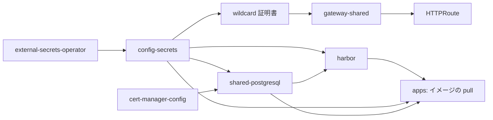

# GitOps

クラスタ内のリソースは、このリポジトリの `main` を ArgoCD が同期して作ります。
[bootstrap-root](../manifests/bootstrap/app-of-apps.yaml) が 37 個の child Application を作り、各 Application が実際のリソースを管理します。

## マニフェストの配置

| ディレクトリ | 置くもの |
|---|---|
| [manifests/bootstrap/](../manifests/bootstrap/) | root と child Application の定義だけ。`core` / `infrastructure` / `platform` / `access` / `user-apps` に分ける |
| [manifests/core/](../manifests/core/) | Namespace、PriorityClass、StorageClass、namespace をまたぐ NetworkPolicy |
| [manifests/infrastructure/](../manifests/infrastructure/) | ネットワーク、証明書、ストレージの controller と設定 |
| [manifests/platform/](../manifests/platform/) | ArgoCD、ExternalSecret、Harbor、RustFS、PostgreSQL、監視、Reloader、Image Updater |
| [manifests/access/](../manifests/access/) | Gateway、DNS、基盤サービスの HTTPRoute |
| [manifests/apps/](../manifests/apps/) | アプリの workload と、そのアプリの HTTPRoute（`access.yaml`） |

管理対象かどうかは、ディレクトリの有無ではなく、Application の `source` から辿って判断します。

### 規約

- このリポジトリを参照する Application の `targetRevision` は `HEAD` にします（`main` と書くと CI が落ちます）。外部の Helm chart は版を固定します。
- アプリを足すときは `manifests/apps/<app>/` と `manifests/bootstrap/applications/user-apps/<app>-app.yaml` をセットで作り、
  同じディレクトリの `kustomization.yaml` に登録します（手順は [アプリ配布](app-delivery.md#アプリを追加する)）。
- アプリの HTTPRoute は `manifests/apps/<app>/access.yaml` に置き、アプリと同じ Application で管理します。
- Issuer と Certificate は [cert-manager/](../manifests/infrastructure/security/cert-manager/)、
  ExternalSecret は [external-secrets/](../manifests/platform/secrets/external-secrets/) に集めます。
- 同じリソースを 2 つの Application から管理しません。`core/` に Application を置きません。
- スクリプトからの `kubectl apply` は bootstrap の最小限だけにします。
- Harbor と RustFS は Helm chart を Kustomize で包んでいます。描画には `kustomize build --enable-helm` が要ります。
- クラスタ全体に効くリソース（PriorityClass、StorageClass、CRD など）を新設するときは、定義だけを先にマージして反映を確認し、
  それを参照する変更は次の PR に分けます。Application 同士の同期順は保証されないためです。

## 変更の流れ

1. マニフェストを編集し、[検証](validation.md) を通す。
2. PR をマージする。ArgoCD は 5 分ごとに Git を確認して同期します（webhook はありません）。
3. Application の状態と、実際の動作を確認する。

```bash
kubectl -n argocd get applications
kubectl -n argocd get application <app> \
  -o jsonpath='{.status.sync.revision}{"\n"}{.status.sync.status}{" / "}{.status.health.status}{"\n"}'
kubectl -n argocd describe application <app>
```

すぐ反映したいときは、ArgoCD の画面で Refresh するか、次を実行します。

```bash
kubectl -n argocd annotate application <app> argocd.argoproj.io/refresh=normal --overwrite
```

すべての Application は自動同期で、`selfHeal` が有効です。手で変えたリソースは元に戻ります。
緊急で手を入れたら、同じ内容をすぐ Git に反映します。

### 切り戻し

Git の変更を revert して同期を待ちます。ただし次の場合は、revert だけでは戻りません。

- DB の migration やデータ形式の変更を伴う場合（データは戻らない）。
- アプリのイメージ: `kustomization.yaml` の digest を revert しても、Image Updater が 2 分ほどで `latest` の digest に戻します
  （[イメージを戻す](app-delivery.md#イメージを戻す)）。
- Application を削除すると、配下のリソースも削除されます。PVC を含む場合は先にデータの扱いを決めます。

## Application 一覧

wave は root が Application を作る順番です。別の Application の中身が準備できたことまでは保証しません。
依存がある場合は、相手の controller が Ready になるまで同期が失敗して再試行されることがあります。

| Wave | Application | Project | Source | Namespace |
|---|---|---|---|---|
| 0 | argocd-projects | default | `platform/argocd-config`（`argocd-projects.yaml` のみ） | argocd |
| 1 | argocd-core | platform | `platform/argocd-config` | argocd |
| 1 | local-path-provisioner | infrastructure | `infrastructure/storage/local-path` | local-path-storage |
| 1 | nfs-subdir-external-provisioner | infrastructure | Helm `nfs-subdir-external-provisioner` | nfs-storage |
| 2 | core | core | `core` | （各リソースが指定） |
| 3 | kube-network-policies | infrastructure | `infrastructure/networking/kube-network-policies` | kube-system |
| 3 | metallb | infrastructure | Helm `metallb` | metallb-system |
| 3 | metrics-server | infrastructure | Helm `metrics-server` | kube-system |
| 4 | metallb-config | infrastructure | `infrastructure/networking/metallb` | metallb-system |
| 5 | gateway-api | infrastructure | `infrastructure/networking/nginx-gateway-fabric/gateway-api` | nginx-gateway |
| 6 | nginx-gateway-fabric | infrastructure | Helm（OCI）`nginx-gateway-fabric` | nginx-gateway |
| 7 | cert-manager | infrastructure | Helm `cert-manager` | cert-manager |
| 7 | cert-manager-config | infrastructure | `infrastructure/security/cert-manager` | cert-manager |
| 7 | external-secrets-operator | platform | Helm `external-secrets` | external-secrets-system |
| 8 | gateway-shared | access | `access/gateway` | nginx-gateway |
| 9 | config-secrets | platform | `platform/secrets/external-secrets` | external-secrets-system |
| 10 | reloader | platform | `platform/reloader` | kube-system |
| 10 | rustfs | platform | `platform/rustfs` | rustfs |
| 10 | shared-postgresql | platform | `platform/shared-postgresql` | database |
| 10 | tailscale-operator | infrastructure | Helm `tailscale-operator` | tailscale |
| 11 | harbor | platform | `platform/harbor` | harbor |
| 11 | image-updater | platform | Helm `argocd-image-updater` + `platform/ci-cd/image-updater` | argocd |
| 11 | observability | platform | `platform/observability` | observability |
| 11 | sandbox-config | platform | `platform/shared-config/sandbox` | sandbox |
| 11 | tailscale-connector | infrastructure | `infrastructure/networking/tailscale-operator` | tailscale |
| 12 | api-hub、blog、cooklog、dashboard、hitomi、hitomi-pdf、hitomi-upload-viewer、home-camera、market-collector、nature-remo、oci-always-free、rsshub | apps | `apps/<app>` | sandbox |
| 13 | platform-access | access | `access/platform`（argocd / harbor / observability / rustfs の経路） | nginx-gateway |
| 14 | dns-core | access | `access/dns/core` | kube-system |
| 14 | dns-tailscale | access | `access/dns/tailscale` | tailscale |

Source の列は `manifests/` からの相対パスです。定義は [bootstrap/applications/](../manifests/bootstrap/applications/) にあり、Helm chart の版もそこに書いてあります。

- `argocd-projects` と `argocd-core` だけ `prune: false` です。upstream から消えたリソースは手で消します。
- `argocd-projects` と `argocd-core` は同じディレクトリを見ます。前者は AppProject のファイルだけを、後者は Kustomize で本体と設定を描画します。
- `platform-access` は基盤の HTTPRoute のほかに、ノードの `/etc/hosts` を直す DaemonSet を持ちます（[Harbor とノードの名前解決](access.md#harbor-とノードの名前解決)）。

### 依存の向き



Harbor が止まっていても、ノードにイメージが残っていればアプリは起動します（`imagePullPolicy: IfNotPresent`）。

## ArgoCD 自身

- 本体は [upstream の install.yaml](../manifests/platform/argocd-config/upstream/kustomization.yaml) を版固定で取り込み、
  [argocd-config/](../manifests/platform/argocd-config/) の patch で設定します。版を上げるのに bootstrap の再実行は要りません。
- ApplicationSet controller は配備していません。Dex は GitHub ログインのために残しています。
- TLS は Gateway で終端するため、server は `server.insecure` で動かします。
- AppProject は `core` / `infrastructure` / `platform` / `access` / `apps` の 5 つで、デプロイ先の namespace を絞っています。
  新しい namespace に置くときは [argocd-projects.yaml](../manifests/platform/argocd-config/argocd-projects.yaml) の destination も足します。

### 通知

`apps` Project の Application は、同期して Healthy になったときと、同期に失敗したときに Slack へ通知します
（[argocd-notifications.yaml](../manifests/platform/argocd-config/argocd-notifications.yaml)）。
成功通知の revision はこのリポジトリの commit で、アプリのソースの commit ではありません。
続いている異常は [監視のアラート](observability.md#アラート) が扱います。

```bash
kubectl -n argocd logs deployment/argocd-notifications-controller --since=10m
```
