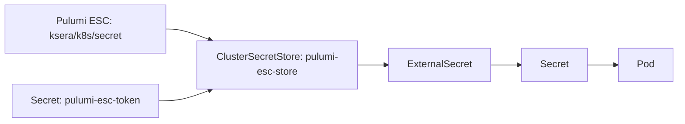

# Secret 管理

Secret の値は Pulumi ESC に置き、External Secrets Operator（ESO）が Kubernetes の Secret にします。
Git には参照（ExternalSecret）だけを置きます。



- ESC に接続する token（`external-secrets-system/pulumi-esc-token`）だけは、`make bootstrap` が直接作ります。
- ExternalSecret はすべて [platform/secrets/external-secrets/](../manifests/platform/secrets/external-secrets/) に置きます（CI が配置を検査します）。
- 参照する ESC のキーは、各 ExternalSecret の `remoteRef.key` が正本です。

## 一覧

| ディレクトリ | 作る Secret（namespace） | ESC のキー |
|---|---|---|
| `argocd/` | `argocd-secret` に追記（argocd） | `argocd` の `client-secret`（GitHub OAuth） |
| | `argocd-notifications-secret` に追記（argocd） | `alertmanager-slack-webhook-url` |
| | `image-updater-git`、`image-updater-harbor`（argocd） | `image_updater.git_ssh_private_key`、`harbor.image_updater_username` / `_password` |
| `harbor/` | `harbor-admin-secret`（harbor） | `harbor.admin_password` |
| | `harbor-internal-secret`（harbor） | `harbor.core_secret` ほか（下記） |
| | `harbor-registry`（sandbox、argocd、default） | `harbor.admin_password`（イメージの pull 用） |
| `networking/` | `cloudflare-api-token`（cert-manager） | `dns-01` |
| | `operator-oauth`（tailscale） | `tailscale.client_id` / `client_secret` |
| `app-runtime/` | `slack`、`cooklog-slack`（sandbox） | `slack`、`cooklog-slack-app-token`、`github` |
| | `rustfs-auth`（rustfs、sandbox） | `rustfs.access_key` / `secret_key` |
| `observability/` | `alertmanager-slack`、`alertmanager-heartbeat`（observability） | `alertmanager-slack-webhook-url`、`alertmanager-heartbeat-url` |
| | `grafana-postgresql`（observability） | `postgresql.password` |
| | `grafana-admin`（observability） | なし（ESO の Password generator が 1 度だけ生成） |
| `postgresql/` | `postgresql-input`（database） | `postgresql.admin_password` / `postgresql.password` |
| | `application-postgresql`（sandbox）、`harbor-database-secret`（harbor） | `postgresql.password` |

`argocd-secret` と `argocd-notifications-secret` は `creationPolicy: Merge` です。ArgoCD 本体が作った Secret に値を足すため、
本体が先に入っている必要があります。

## 値を変える

1. ESC の値を変える。
2. ESO は 1 時間ごとに取り直します（GitHub OAuth だけ 15 分）。すぐ反映するなら次を実行します。

   ```bash
   kubectl -n <namespace> annotate externalsecret <name> force-sync="$(date +%s)" --overwrite
   ```

3. Secret を使う Pod が新しい値を読んだことを確認する。環境変数で読む Pod は、再起動するまで古い値のままです（下の Reloader）。

状態の確認:

```bash
kubectl get clustersecretstores
kubectl get externalsecrets -A
kubectl -n <namespace> describe externalsecret <name>
```

値を変えるだけでは済まないもの:

- **PostgreSQL のパスワード**: Secret を変えても DB の中のパスワードは変わりません。[手順](postgresql.md#パスワードを変える) に従います。
  `app` のパスワードは全アプリ・Harbor・Grafana が共用しています。
- **Harbor の内部認証**（下記）: 鍵と証明書、password と htpasswd の組を揃えて変えます。`encryption_key` を変えると、Harbor の DB に保存済みの値を復号できなくなります。
- **Grafana の管理者**: `grafana-admin` は初回の DB 初期化にだけ使われます。UI で変えたパスワードとは連動しません。Secret を消してもリセットにはなりません。

## Reloader

[Reloader](../manifests/platform/reloader/manifest.yaml) は、Secret や ConfigMap が変わったときに、annotation を付けた workload を再起動します。
見ているのは **`sandbox` と `observability` だけ** で、Job と CronJob は対象外です。

| 対象 | 再起動のきっかけ |
|---|---|
| api-hub、hitomi-outbox、media-api、media-worker、home-camera | 参照しているすべての Secret / ConfigMap（`reloader.stakater.com/auto`） |
| Alertmanager | `alertmanager-slack`、`alertmanager-heartbeat` |
| Grafana | `grafana-postgresql` |

`harbor` と `database` は Reloader の対象外です。Harbor と PostgreSQL のマニフェストにも annotation はありますが、効きません。
これらの Secret を変えたら、手で再起動します。

```bash
kubectl -n harbor rollout restart deployment harbor-core harbor-jobservice
kubectl -n database rollout restart statefulset postgresql
```

対象を増やすときは、workload の annotation、Reloader の `--namespaces`、その namespace の Role / RoleBinding を揃えます。
Reloader が Pod template に書く annotation を ArgoCD が差分と見なさないよう、Application の `ignoreDifferences` も足します
（[observability の例](../manifests/bootstrap/applications/platform/observability.yaml)）。

## Harbor の内部認証

Harbor の chart は、放っておくと描画のたびに内部の鍵を乱数で作り直します。
それを避けるため、[harbor-internal-secret](../manifests/platform/secrets/external-secrets/harbor/harbor-internal-secret.yaml) に固定の値を入れ、
[values.yaml](../manifests/platform/harbor/values.yaml) から参照しています。

| ESC の `harbor.` 配下 | Secret のキー |
|---|---|
| `core_secret` / `encryption_key` | `secret` / `secretKey` |
| `token_cert` / `token_key` | `tls.crt` / `tls.key` |
| `xsrf_key` / `jobservice_secret` | `CSRF_KEY` / `JOBSERVICE_SECRET` |
| `registry_secret` | `REGISTRY_HTTP_SECRET` |
| `registry_password` / `registry_htpasswd` | `REGISTRY_PASSWD` / `REGISTRY_HTPASSWD` |

## GitHub 側の Secret

クラスタの外で使う認証情報は、GitHub の Actions Secret にあります。

| Secret | 場所 | 用途 |
|---|---|---|
| `TS_OAUTH_CLIENT_ID`、`TS_AUDIENCE`、`HARBOR_USERNAME`、`HARBOR_PASSWORD` | Organization（private のリポジトリは個別） | アプリの CI が Tailscale 経由で Harbor に push する（[アプリ配布](app-delivery.md#ci-の認証情報)） |
| `TS_POLICY_CLIENT_ID`、`TS_POLICY_CLIENT_SECRET` | このリポジトリ | Tailnet の ACL の適用（[アクセス経路](access.md#tailnet)） |
