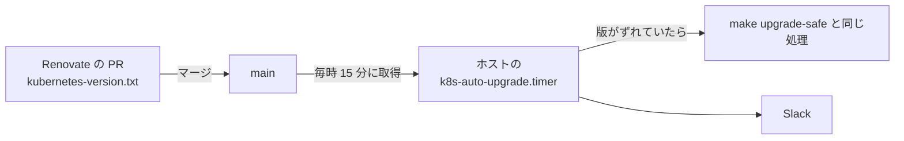

# 更新

| 対象 | 方法 |
|---|---|
| 公開イメージ、外部の Helm chart | Renovate の PR を手でマージ |
| PostgreSQL | minor は Renovate、major は手作業 |
| Harbor、RustFS の chart | 手作業 |
| ArgoCD、Gateway API の CRD | 手作業 |
| 自作アプリのイメージ | 自動（[アプリ配布](app-delivery.md)） |
| アプリのリポジトリの依存 | 各リポジトリの Renovate の PR |
| Kubernetes | Renovate の PR をマージすると、ホストの timer が自動で適用（下記） |
| containerd | スクリプト（下記） |
| ホストの OS | unattended-upgrades。再起動は手作業（[日常運用](operations.md#ホストを再起動したあと)） |

自動でマージされる更新はありません。Kubernetes だけは、マージがそのままクラスタへの適用になります。

## Renovate（このリポジトリ）

[renovate.yml](../.github/workflows/renovate.yml) が毎日 09:00 JST に動き、[renovate.json](../renovate.json) の設定で PR を作ります。

- 対象は `manifests/` のコンテナイメージと、bootstrap の Application が指す Helm chart の版です。
- 公開から 3 日待ちます。同時に開く PR は 3 件までです。
- major の更新は、Dependency Dashboard（issue）でチェックを入れてから PR が作られます。
- Loki と Alloy、VictoriaMetrics と vmalert、PostgreSQL は、それぞれ 1 つの PR にまとまります。
- [kubernetes-version.txt](../kubernetes-version.txt)（Kubernetes の版）も対象です。minor は 1 つずつ PR になり、公開から 7 日待ちます。
- `targetRevision: HEAD`、自作イメージの `latest`、同梱した chart、upstream の取り込み、`automation/` は対象外です。
  GitHub Actions の版も更新しません。

Renovate の PR には、workflow が検証を明示的に起動します（[dispatch-renovate-validation.py](../automation/scripts/ci/dispatch-renovate-validation.py)）。
検証が最新の commit で通っていることを見てからマージします。

### マージの前に見ること

- 描画結果で、リソース名、selector、PVC、Secret の参照が変わっていないか。CRD が変わるか。
- データを持つもの（PostgreSQL、Harbor、RustFS、Loki、VictoriaMetrics）は、リリースノートで保存形式の変更を確かめる。
  形式が変わる更新は、古い版に戻しても復旧できません。
- 反映後は、Application の状態だけでなく、そのサービスを実際に使って確かめる。

**NGINX Gateway Fabric** を上げるときは、対応する Gateway API の CRD の版を確かめます。CRD が先です
（[gateway-api/](../manifests/infrastructure/networking/nginx-gateway-fabric/gateway-api/) のファイルを差し替えて反映を確認してから、chart を上げる）。
反映後に Gateway と Route の状態、Harbor への push（本文サイズの制限解除）、nature-remo の送信元制限を確かめます。

## PostgreSQL

同じタグ（`postgres:<major>.<minor>`）を、StatefulSet、バックアップの CronJob、Harbor の待機用 init container（2 か所）で使います。

**minor**: Renovate が 4 か所をまとめた PR（`PostgreSQL`）を作ります。マージすると再起動し、数十秒つながらなくなります。

```bash
kubectl -n database rollout status statefulset/postgresql
kubectl -n database exec postgresql-0 -- psql -U postgres -Atc 'show server_version'
```

**major**: データディレクトリに互換性がないため、Renovate では止めています。

1. [手動バックアップ](postgresql.md#バックアップ) を取り、成功を確かめる。
2. DB に書き込むものを止め、もう一度 dump を取る。
3. 4 か所のタグを上げ、StatefulSet と PVC `data-postgresql-0` を消して、空の DB で起動させる。
4. [復元](postgresql.md#復元) し、行数を確かめて、止めたものを戻す。

## Harbor、RustFS の chart

chart は `manifests/platform/<name>/charts/` に同梱しています。

1. `kustomization.yaml` の `helmCharts[].version` を上げる。
2. 古い `charts/<name>-<旧版>/` を消し、`kustomize build --enable-helm manifests/platform/<name>` を実行して新しい版を取得する。
3. 描画結果の差分を見る。特に、patch が当たっているか（Harbor の DB 待機、ConfigMap）、`resources` が全コンテナに残っているか。
4. `make validate` を通し、PR にする。

Harbor は DB の migration を伴うことがあります。先に [DB のバックアップ](postgresql.md#バックアップ) を取ります。
RustFS は更新時に必ず止まります。

## ArgoCD

[upstream/kustomization.yaml](../manifests/platform/argocd-config/upstream/kustomization.yaml) の URL の版を書き換えます。
ArgoCD が自分自身を更新するので、bootstrap の再実行は要りません。
[platform-deploy.sh](../automation/platform/platform-deploy.sh) は同じファイルから版を読むため、別に直すところはありません。

`argocd-core` は `prune: false` です。新しい版で不要になったリソースは残るので、リリースノートを見て手で消します。

## アプリのリポジトリ

8 つのリポジトリには Mend Renovate の GitHub App が入っていて、共通の preset を参照します。

```json
{ "extends": ["github>home-lab-ksera/home-lab-k8s//.github/renovate/app"] }
```

[preset](../.github/renovate/app.json) は、週 1 回、major 以外をリポジトリごとに 1 つの PR にまとめます。major は Dependency Dashboard で承認してからです。
共通の publish workflow（`@main`）と Harbor の自作イメージは対象から外しています。
マージすると、通常の配布の流れでクラスタに出ます。

## Kubernetes

版は [kubernetes-version.txt](../kubernetes-version.txt) の 1 行だけで決まります。
更新スクリプト、自動更新、作り直し（[variables.tf](../automation/infrastructure/variables.tf) は既定でこのファイルを読む）が同じ値を使います。



### マージの前に見ること

- [CHANGELOG](https://github.com/kubernetes/kubernetes/tree/master/CHANGELOG) の Urgent Upgrade Notes と、削除される API。
- Flannel、NGINX Gateway Fabric、ArgoCD、metrics-server、kube-state-metrics が新しい版に対応しているか。
- マージすると 1 時間以内に始まります。API サーバーは短く止まり、worker の Pod は drain で止まります。見ていられる時間にマージします。

### 自動更新（ホスト）

[auto-upgrade.sh](../automation/scripts/upgrade/auto-upgrade.sh) が毎時 15 分に、自動更新専用の clone（`~/home-lab-k8s-auto`）を main に合わせてから判定します。

| 状態 | 動き |
|---|---|
| クラスタが目標の版 | 何もしない |
| pkgs.k8s.io にまだパッケージがない、API につながらない | 何もしない（次の回に再判定） |
| 事前ゲート（Node、Pod、ArgoCD）が通らない | Slack に 1 回知らせて待つ。通ったら始める |
| patch、または minor 1 つ上 | Slack に開始を知らせて `upgrade-safe` を実行し、結果を知らせる |
| 失敗、版の後退、minor の飛び越し、ノード間で版が混在 | Slack に知らせて **停止**。解除するまで何もしない |

通知先は Alertmanager と同じ Slack です（設置時に Secret `alertmanager-slack` から写します）。

```bash
# ホストで
journalctl -u k8s-auto-upgrade -n 200 --no-pager            # 直近の判定と実行のログ
~/home-lab-k8s-auto/automation/scripts/upgrade/auto-upgrade.sh --dry-run   # 次に何をするか
systemctl list-timers k8s-auto-upgrade.timer
```

**停止したとき**: ログ（`journalctl` と `~/home-lab-k8s-auto/automation/run.log`）で止まった段階を確かめます。
worker の途中で止まった場合、そのノードは cordon されたままです。直したら、手で `make upgrade-safe` を最後まで通すか、
状態を戻してから `auto-upgrade.sh --clear-failure` で再開します。

**設置**（1 回だけ。ホストで実行し、systemd への登録で sudo のパスワードを聞かれます）:

```bash
git clone https://github.com/home-lab-ksera/home-lab-k8s.git ~/home-lab-k8s-auto
~/home-lab-k8s-auto/automation/host-setup/install-auto-upgrade.sh
```

設置スクリプトは `settings.toml` を作り（なければ）、dry-run の結果を表示してから timer を有効にします。
止めるときは `sudo systemctl disable --now k8s-auto-upgrade.timer` です。

### 手で上げるとき

入口は Makefile、実体は [upgrade/](../automation/scripts/upgrade/) です。版は kubernetes-version.txt から読みます
（`settings.toml` の `[upgrade].target_version` は使いません。残っていて値が違うと止まります）。
自動更新と同時に動かさないよう、先に timer を止めるか、kubernetes-version.txt の PR をマージしてから実行します。

```bash
kubectl get nodes -o wide
make upgrade-safe
```

`upgrade-safe` の順序:

1. 事前ゲート: Node、異常な Pod、ArgoCD の状態を確認（失敗したら 30 秒おきに 3 回まで再試行）
2. precheck: SSH、etcd の snapshot、`kubeadm upgrade plan`
3. control-plane を更新
4. worker を更新（drain は 10 分で打ち切り）
5. postcheck（apiserver と全ノードが目標の版か）と事後ゲート

分けて実行することもできます。順序は守ります。

```bash
make upgrade-precheck
make upgrade-control-plane
make upgrade-workers
make upgrade-postcheck
```

- `make upgrade` はゲートなしの同じ処理です。通常は `upgrade-safe` を使います。
- precheck は etcd の snapshot を etcd の Pod の中（`/var/lib/etcd/etcd-snapshot-<時刻>.db`）に作ります。control-plane の外へは退避しません。
- 更新中、API サーバーは短く止まります。worker の更新中は、そのノードの Pod が止まります。
- kubeadm の upgrade は control-plane の証明書も更新します。
- 更新後、`kubeadm`、`kubelet`、`kubectl` は `apt-mark hold` で固定されます。
- 終わったら [日々の確認](operations.md#日々の確認) に加えて、URL、Harbor の pull、DB を使うアプリを確かめます。

## containerd

[containerd-upgrade-safe.sh](../automation/scripts/upgrade/containerd-upgrade-safe.sh) は、**指定した 1 ノードだけ** を処理します。

`settings.toml` の `[upgrade]` に、`containerd_target_version`（上げ先）、`containerd_current_version`（戻し先）、
`containerd_canary_node`（最初に試すノード）を書きます。戻し先は、実機の現在の版と一致させます。

```bash
make containerd-precheck
make containerd-safe                                                         # canary のノードだけ
./automation/scripts/upgrade/containerd-upgrade-safe.sh --node <node>        # 残りのノード
```

処理は、cordon → drain（emptyDir の中身は消える）→ パッケージの更新 → containerd と kubelet の再起動 → Ready の確認 → uncordon です。
失敗しても、自動では戻りません。どの段階で止まったかを見て、必要なら戻します（戻すときも drain と再起動が起きます）。

```bash
./automation/scripts/upgrade/containerd-upgrade-safe.sh --rollback --node <node>
```
