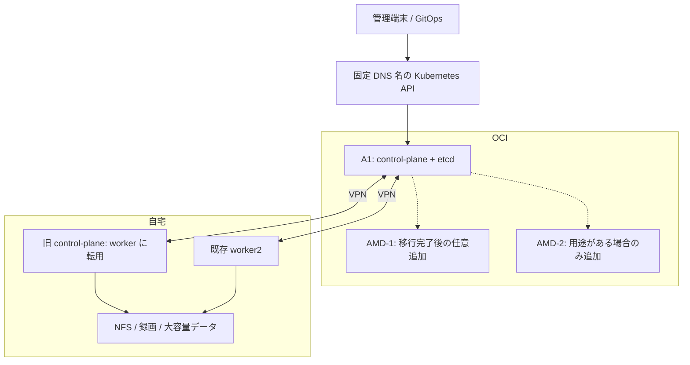

# 自宅・OCI 単一 Kubernetes クラスタ拡張計画

作成日: 2026-11-03

改訂日: 2026-11-03（A1 確保を変更開始条件に変更）

状態: 実装計画。実機調査・各ゲートの検証・クラスタや OCI への反映は未実施。

本書の Phase は移行計画の区分であり、`make phase1` / `make phase2` / `make phase5` とは対応しない。
チェック欄は実施と証跡確認が済んだ場合にのみ完了にする。

## 1. 目的と合意事項

自宅と OCI のノードを、現在の Kubernetes クラスタに属する計算資源として扱う。
既存の kubeadm、Argo CD、マニフェストを活用し、アプリは引き続き
Deployment / StatefulSet / Job / CronJob として実行する。

- Kubernetes クラスタは1つ。クラスタを横断する管理・スケジューラは追加しない。
- **A1 確保前は読み取り調査・設計のみ。VPN 構築、既存クラスタ設定変更、OCI ノード参加を開始しない。**
- A1 確保後に受け入れ準備と検証を行い、開始条件を満たしてから control-plane と etcd を OCI へ移す。
- 現在の自宅 control-plane VM は、移行完了後に worker へ転用する。
- OCI AMD は必須経路から外す。移行と旧ノードの worker 化が完了した後に、1台ずつ worker としての採否を決める。
- 通常のアプリは、CPU アーキテクチャ・データ依存・リソース条件を満たすノードに配置する。
- 録画、自宅 NFS、大容量データに依存する処理は自宅に配置する。
- アプリの実行を systemd worker に置き換えない。VPN・kubelet・containerd などのノード基盤は OS 上で管理する。

OKE、複数クラスタ、Hosted Control Plane、Karmada は採用しない。
外部監視専用基盤、定期的な別拠点バックアップ、DB の MySQL / Autonomous DB への移行も本計画の対象外とする。
control-plane 移行時の一時的な状態保全は、切り戻しのために実施する。
本計画の必須完了は Phase 6。AMD 追加と A1 への一般アプリ追加は任意の Phase 7 とし、未実施でも必須完了を妨げない。

## 2. 現状と目標構成

現状はリポジトリの宣言から確認したもの。実際の Kubernetes バージョン、ノード容量、
稼働 Pod、OCI の設定は実装前に読み取りで確認する。

| 項目 | 現状 |
|---|---|
| control-plane | `k8s-control-plane` / `192.168.122.10` |
| worker | `k8s-worker2` / `192.168.122.12`。control-plane も workload を受ける（2026-11-12 に 2VM 化） |
| API endpoint | `192.168.122.10:6443` |
| CNI | Flannel。NetworkPolicy の実行は別 DaemonSet |
| Pod / Service CIDR | `10.244.0.0/16` / `10.96.0.0/12` |
| Gateway / Split DNS | `192.168.122.100` / `192.168.122.101` |
| NFS | `192.168.122.1:/mnt/k8s-storage/nfs-share` |
| Tailscale | クラスタ内 Connector が `192.168.122.0/24` を広告 |
| OCI AMD | E2.1.Micro × 2台、各1 GB。ユーザー提示の確保状況 |
| OCI A1 | 未確保。確保時期・実際の割当量は未定 |
| OCI ストレージ | 提示情報はブート50 GB × 2。上限・未使用ボリュームを含む実消費・A1 用残量は実機確認待ち |

図は制御経路の概要。実際には全参加ノード間で CNI に必要な通信も成立させる。
A1 は control-plane の余力を確認した後、明示的に許可したアプリの配置先にもできる。
初期は control-plane 用 taint を維持する。

### 運用上の前提

- 単一 control-plane であり、HA 化ではない。
- OCI の control-plane が停止するとクラスタ制御が止まる。既存 Pod の継続は依存先・ノード状態による。
- 拠点間通信断では自宅 worker の状態更新や新規配置ができない。既存 Pod の無停止は保証しない。
- 自宅固定の DB も制御系への依存を持つ。共有 PostgreSQL の Patroni は Kubernetes API への到達性と実効設定により書込み継続に影響を受けるため、Phase 3 / 5 で確認する。
- 自宅と OCI に etcd を1台ずつ恒久配置しない。2投票メンバーでは片側停止に耐えられない。
- 自宅の Harbor、DNS、DB、Admission Webhook などへの依存が残れば、OCI 側も影響を受ける。
- 自宅・OCI で CPU アーキテクチャ、ストレージ、遅延が異なる。全 Pod を無条件に自由配置しない。
- Always Free の適用枠、アイドル回収条件、サービス制限は実装時に確認する。

## 3. 基盤の設計方針

### 3.1 ネットワークと API endpoint

既存 Tailscale の利用を第一候補とする。ただし、現在の Connector だけで
双方向のノード間ネットワークが完成すると判断しない。
各ノードの OS 上に VPN を配置する方法と、クラスタ外のルーターで拠点間接続する方法を比較し、
Phase 0 で一方を選ぶ。VPN の成立をアプリ Pod や Argo CD の起動に依存させない。
Phase 0 では方式を設計し、A1 の実際のネットワークとの差分を Phase 1 の変更前に確定する。
採用方式には OS 起動時の自動復旧、VPN 認証の更新、クラスタ停止中に使える管理経路を含める。

確認・設計する通信:

- worker → API server の TCP 6443。
- control-plane / 監視 → 各 kubelet の TCP 10250。
- 全ノード間の Flannel backend 通信。実際の backend と port は稼働設定から確認する。
- 拠点をまたぐ Pod 間、ClusterIP、CoreDNS、NetworkPolicy 適用後の通信。
- OCI ノードの containerd → 自宅 Harbor の名前解決、TLS、認証付き pull。
- control-plane → Admission Webhook / 集約 API など、必要な Service への通信。
- 移行中の etcd メンバー間通信。必要な期間・ノードだけに許可する。

VCN、VPN、自宅 LAN、Pod、Service のアドレス重複を確認する。
ノードの InternalIP と Flannel の広告先 IP、双方向ルート、NAT の有無を一覧化する。
VPN と CNI のカプセル化を考慮して MTU を測定し、通信の片方向成功だけで合格にしない。
自宅の既存 InternalIP は、可能な限り維持する方針で設計する。

API には、自宅 control-plane の IP に依存しない固定 DNS 名を導入する。
その名前解決はクラスタ内 CoreDNS / 自宅 Split DNS だけに依存させない。
最初は既存 control-plane を指し、証明書 SAN と接続設定を揃えてから OCI へ切り替える。
名前と解決先は Phase 0 で決定し、例示名を実際の設定として使わない。
API と etcd を一般インターネットへ無制限に公開しない。
固定 DNS 名の導入は Phase 4 で行う。Phase 1〜3 では旧 API endpoint を維持し、
保守スクリプトは切替前後の接続先を明示指定できる状態まで準備する。

### 3.2 配置とリソース

配置ラベルは例として `homelab.k8s-myhome.local/site=home|oci`、
`homelab.k8s-myhome.local/capacity=micro|standard` を用意する。命名は実装時に既存規約と照合する。
CPU アーキテクチャは標準ラベル `kubernetes.io/arch=amd64|arm64` を使用する。

OCI ノードは kubelet 登録時から隔離用の `NoSchedule` taint を付け、参加直後の意図しない配備を防ぐ。
検証済み Pod のみに toleration と配置条件を与える。
taint を許容する DaemonSet は参加直後から動くため、事前に全件点検する。

| 対象 | 配置方針 |
|---|---|
| 録画、NFS 依存、RustFS、共有 PostgreSQL | 自宅固定から開始 |
| blog / cooklog の配信など PVC 不要のアプリ | OCI 配置の最初の候補 |
| api-hub / media API | DB・S3 への遅延と可用性への影響を確認して判断 |
| AMD 上のアプリ | 小型 Pod 1つから。OOM / eviction / CPU 飽和があれば縮小または参加を取りやめる |
| A1 上のアプリ | control-plane の予約量を確保し、ARM 対応後に許可 |
| CI runner | 既存 Organization 共通 runner の方針を維持。repo 別 ScaleSet は増設しない |

AMD の1 GBは kubeadm の公式案内の各マシン2 GB以上を下回る。
採用は保証せず、OS・VPN・kubelet・containerd・必須 DaemonSet を含む実測で判断する。
必要なネットワーク保護を無効化してメモリを節約する構成にはしない。

CPU の requests / limits と実測を使い、VM の表示 vCPU 数だけで処理能力を判断しない。
OS・VPN・kubelet・containerd・必須 DaemonSet・control-plane・etcd の予算と余裕を別々に算出する。
worker 検証時の空き容量を control-plane 化後の余裕とみなさない。予約・eviction 設定は混在ノードの容量に合わせ、更新後も維持する方法を定める。
アプリと全 DaemonSet のイメージについて、使用するタグ / digest の ARM 対応を確認する。
AMD64 専用イメージには配置制約を設定し、エミュレーションを標準運用にしない。

### 3.3 ストレージ、公開、管理機能

- OCI の初期 workload は PVC 不要とする。自宅 NFS の WAN 越し利用は標準構成にしない。
- local-path / local PV のデータはノードに属する。旧 control-plane 上のデータを転用前に棚卸しする。
- MetalLB の L2 広告対象を自宅ノードに限定する。Gateway・DNS も初期は自宅配置を維持する。
- OCI の既存プライベート LB / NLB の利用は必須にしない。利用する場合は経路と必要性を別途設計する。
- Argo CD は既存の1系統を維持する。OCI への配置変更は通信・永続化・イメージ取得の依存を確認した後に判断する。
- control-plane / etcd のイメージ取得・起動に、自宅 Harbor の稼働を必須としない。
- 各ノードの kubelet メトリクス、証明書更新、既存アラートが追加ノードでも成立するようにする。

### 3.4 保守対象と接続先の管理

ノード名、役割、拠点、アーキテクチャ、InternalIP、SSH 接続先・ユーザー・鍵参照、VPN アドレスを対応付ける。
API の固定 DNS 名と SSH 接続先は別項目とし、旧 `k8s-control-plane` という名前を OCI の SSH 接続先へ読み替えない。

現行 `upgrade-workers.sh` は worker 2台の設定を列挙し、`containerd-upgrade-safe.sh` は既存3ノード名を固定対応している。
`verify.sh` は control-plane に SSH して kubeconfig を取得し、`recover-after-reboot.sh` は自宅 libvirt VM を起動する。
これらの対象選択を Phase 1 で拡張する。A1 参加時から保守対象に含め、Phase 4 の切替時に既定の接続先を更新する。
接続先が不明なノードは処理を失敗させ、旧 IP へ暗黙にフォールバックしない。
復旧処理は自宅 VM と OCI の起動を区別し、移行済みの旧制御コンポーネントを復活させない。
自宅 VM 作成用 Terraform の IP 変数を、運用先が移ったことだけを理由に A1 の IP へ置き換えない。
既存 VM / Terraform state と OCI の準備資産を分離し、通常保守から自宅 VM の再作成・初期化へ入れないようにする。

## 4. 段階的な導入と進行条件

### 4.1 依存関係とゲート

| Phase | 実施内容 | 開始条件 | 完了ゲート |
|---|---|---|---|
| 0 | 読み取り調査・設計 | なし。A1 不要 | G0: 現状・設計案・未決事項・変更対象が記録済み |
| 1 | A1 確保確認・受け入れ準備 | G0 + A1 実機確保 | G1: ホスト通信・配置・保守対応が整い、既存サービス正常 |
| 2 | A1 の隔離 worker 検証 | G1 | G2: ARM・通信・運用・容量の検証合格 |
| 3 | 移行・復旧リハーサル | G2 | G3: 実行手順と障害試験、復元、停止予算が検証済み |
| 4 | control-plane / etcd 移行 | G3 + 作業直前確認合格 | G4: 旧 VM 停止下で制御・管理・必要サービス正常 |
| 5 | 移行後の障害試験・受け入れ | G4 | G5: 最終制御構成の通信断・再起動・復帰が基準内 |
| 6 | 旧ノード worker 化・運用引継ぎ | G5 | G6: 全必須ノードの保守とサービスを確認し記録完了 |
| 7 | AMD / A1 一般アプリの任意追加 | G6 | 追加ごとの受け入れ。必須完了とは独立 |

各ゲートの記録には実施日時、対象ノード・版・Git commit、実行結果、残課題、実施者を残す。
失敗・未検証・必要値未確定のまま後続へ進まない。構成を変更した場合は影響する検証をやり直す。
保留が長期化した場合は、再開前に版・証明書期限・VPN 認証・容量・既存サービスの状態を再確認する。
A1 が失われた場合は新たな段階へ進まず、その時点の状態に対応する第5節の復旧に従う。

### 4.2 実機情報で確定する設計記録

以下は未確定。値を推測で埋めず、記録を用意し、期限までに確定する。
G0 は調査で未決事項を特定した状態で通過できるが、G1 以降は該当項目の未確定を許容しない。
記録は本書への追記または `tasks/` 内の関連文書で管理し、秘密情報は記載しない。

| ID | 確定内容 | 確定期限 |
|---|---|---|
| D1 | 稼働 Kubernetes / kubeadm / etcd / containerd / CNI の版・設定、使用イメージ、更新互換性 | G0。各変更前に差分再確認 |
| D2 | A1 の OCID 参照・リージョン・shape・CPU・メモリ・OS・ディスク、無料枠と総使用量 | Phase 1 の変更開始前 |
| D3 | VPN 方式、全 CIDR / IP / ルート / NAT / ACL、CNI backend・port・MTU、API DNS / SAN / TTL と管理主体 | Phase 1 の変更開始前 |
| D4 | ノード台帳、配置条件、必須 DaemonSet、ARM 対応、API・SSH・証明書・監視・保守の対象表 | G1 |
| D5 | CPU・メモリ予約、空きディスク下限、遅延・転送・etcd 応答の上限、観測頻度と期間 | G1 で試験基準を確定し、G3 で control-plane 実測による適合を確認 |
| D6 | 旧ノード上の workload / データ / PDB、退避先と容量、整合性確認とデータ固有の切り戻し | G3 |
| D7 | 作業日時・実施担当、サービス別の許容停止時間、各操作の timeout、2投票メンバー状態の最大時間 | Phase 1 の変更前に準備作業分を確定。G3 までに移行・受け入れ試験分を確定 |
| D8 | クォーラム復旧を待つ期限、復元先、snapshot 復元時間、許容する Kubernetes 状態損失、保全物の保管先・保持期限 | G3 |
| D9 | 通信断の長さ、Patroni の実効設定、サービス別の断中の許容状態・復帰期限・手動復旧操作 | G3 |

D7 の作業枠には検証・切り戻し・復元の所要時間を含める。残り時間が復旧予算を下回る前に中止判断する。
D8 の損失許容は snapshot の経過時間だけでなく、取得後の Secret・PVC・Job などの変更内容でも評価する。
D9 の障害注入時間は Node / Pod の判定・退避と Patroni の実効 timeout を観測できる長さにし、
短時間の ping 成功だけを合格にしない。停止許容はサービス所有者が記録する。未合意なら G3 を通過しない。

### Phase 0: 読み取り調査・設計（A1 確保前に実施可能）

- [ ] D1 を調査し、リポジトリ宣言と稼働状態の差分を記録する。
- [ ] 全 Node / Pod / DaemonSet / PVC / PV / PDB、配置、リソース、Admission Webhook、APIService、外部依存を棚卸しする。
- [ ] OCI の現有リソース・割当制限・容量を読み取りで確認し、A1 の必要容量を設計する。
- [ ] D3〜D9 の案、調査方法、変更対象、静的検証・実機検証の方法を定める。
- [ ] A1 確保待ちの間は現行構成のまま保守する。AMD 参加・VPN 導入・API DNS 切替は行わない。

**G0:** 現状記録と設計案があり、未決事項と確定期限が明示されている。
ローカルの設計文書・手順案の作成は可能だが、稼働環境は変更しない。
A1 調達は Phase 1 の外部前提として扱い、本書作成によって作成・課金を実行したことにはしない。

### Phase 1: A1 確保確認と受け入れ準備

**開始条件:** G0 完了。A1 の作成要求だけでなく、実インスタンスが起動し、SSH / コンソールから管理できること。

- [ ] D2 / D3 を実機で確定する。A1 の容量・ディスク予算が不足する場合は既存クラスタを変更せず保留する。
- [ ] VPN / CNI 変更と既存ノード再起動の停止範囲・作業枠・中止期限・設定復元方法を D7 に記録する。既存サービスが停止し得る準備作業も計画停止として扱う。
- [ ] 変更前のホスト設定、CNI 設定、GitOps revision と正常性の基準値を保全する。
- [ ] OS 起動に連動する VPN を準備し、全参加予定ノード間の双方向通信、再起動後の接続、管理用の代替経路を確認する。
- [ ] 自宅固定条件、MetalLB の自宅限定 L2 広告、Gateway / DNS の配置、DaemonSet の適用範囲を GitOps で反映する。
- [ ] Flannel の広告先・インターフェース・MTU を必要な範囲で変更する。既存 Pod の再作成要否と順序を定め、変更ごとに自宅内通信と既存サービスを確認する。
- [ ] kubelet 証明書台帳・RBAC・NetworkPolicy・監視を A1 に対応させる。追加 API IP の許可は旧 IP を残して準備する。
- [ ] 非破壊のノード準備・参加・離脱手順と、ノード単位の保守入口を作成する。`make all` / `make phase2` は使用しない。
- [ ] 第3.4節の保守対象選択を実装し、A1 を含む台帳で宛先・役割・対象一覧を検証する。API 到達だけの検査と、変更を伴う bootstrap / upgrade を区別する。
- [ ] API DNS と SSH 接続先を分離した新旧設定を用意する。既定の API 接続先はこの段階で変更しない。
- [ ] D4 / D5 を確定し、各差分の静的検証と既存 workload の正常性を確認する。

**G1:** A1 を参加させる前に、配置制約・通信・証明書・保守の準備が揃っている。
既存サービスに未解決の退行があれば変更を戻し、Phase 2 に進まない。

### Phase 2: A1 の隔離 worker 検証

**開始条件:** G1 完了。使用する ARM イメージの提供と、taint を許容する全 DaemonSet の設定・予算が確認済み。

- [ ] 既存クラスタと整合する kubeadm / kubelet / containerd を用意し、登録時から隔離 taint 付きで A1 を worker として参加させる。
- [ ] 検証専用の PVC 不要 Pod だけを明示配置し、第7節の T1〜T4 を実行する。
- [ ] kubelet 証明書の発行、`logs` / `exec` / port-forward、メトリクス、保守スクリプトの対象選択を実機で確認する。
- [ ] A1 側のみの切断・再起動を行い、Node / Pod / EndpointSlice と復帰時間を記録する。これは移行後の自宅切断試験の代用にしない。
- [ ] 通常負荷で連続7日間観測し、非注入の OOM / eviction / DiskPressure が0件、D5 の基準内、既存サービスへの退行なしを確認する。障害注入試験は通常観測と分けて記録する。
- [ ] A1 の worker 構成を維持する間の更新・証明書・VPN 認証管理を運用へ含める。

**G2:** Ready に加え、ネットワーク保護・運用操作・ARM・容量・障害復帰に合格している。
不合格なら A1 の一般利用を開始せず、原因修正後に影響範囲を再試験する。採用不能なら安全に離脱して保留する。

### Phase 3: 移行・復旧リハーサルと作業条件の確定

**開始条件:** G2 完了。本番とは経路・DNS・認証の利用範囲を分離した検証環境を用意できること。

- [ ] 実バージョンと WAN 遅延・損失条件を再現し、worker から control-plane への変更を含めた Phase 4 の順序を検証する。
- [ ] A1 は原則、検証 Pod の退避、worker 離脱・reset、control-plane として再参加する手順を採用する。reset 対象・CNI 残存状態・Node / PodCIDR・証明書の扱いを明記し、preflight の無視で既存 worker に上書き join しない。
- [ ] 現行 API server の実マニフェストと kubeadm 永続設定を照合し、ホスト依存一覧を作る。Secret 暗号化鍵と provider 順序、PKI・ServiceAccount 署名鍵、監査ポリシー・ログディレクトリ・権限を含める。
- [ ] A1 に必要なホスト設定を準備する。既存鍵の移送と新規生成を区別し、reset 後にも必要ファイルが存在する確認を手順に含める。
- [ ] D6 のデータ退避を検証する。旧ノードを除く自宅 worker に必要な容量がなければ、退避先を確保するまで進まない。
- [ ] etcd の追加・同期・投票状態の確認・旧メンバー除去を検証する。使用版の learner 動作を確認し、2投票メンバーの時間と etcd の遅延・ディスク性能を測る。
- [ ] 2投票メンバー期間の通信断・片側停止について、正常復旧と snapshot 復元の両分岐を検証する。
- [ ] snapshot と鍵・設定一式から隔離環境に復元し、Secret 読み書き・API / controller 再開を確認する。使用する etcd 版に応じた revision 巻き戻り対策と watch / cache の再同期も手順化する。
- [ ] 最終配置を再現し、自宅から API が見えない場合を検証する。共有 PostgreSQL の Patroni / PGO の版と実効 `failsafe_mode`・timeout を確認し、DB 書込み・Harbor・Gateway・DNS・Argo CD・Webhook への影響と復帰を記録する。
- [ ] D5 の control-plane 予算、D6〜D9、作業担当と実行手順を確定する。既存の DB 保護機構を試験合格のために無効化しない。
- [ ] 本番に適用する全変更について `automation/scripts/ci/validate.sh` を通し、ホスト変更は隔離環境で再実行性と途中失敗からの再開を確認する。

**G3:** 実際のコマンド、対象、期待結果、timeout、中止条件、復旧分岐を含む手順があり、検証記録と対応している。
データ退避・復元・移行後の障害挙動が停止予算に収まり、未確定の必須値がない。
自宅 DB の停止が D9 の許容を超える場合は、配置だけで解決済みとせず設計を修正して再検証する。
本番の etcd メンバー構成はまだ変更しない。

### Phase 4: control-plane / etcd 移行

**開始条件:** G3 完了。版・鍵・設定の差分を再確認し、必要な再検証が済んでいる。作業枠と復旧経路を確保済み。
以下の順序と確認点を実行手順に落とし込む。メンバー変更とバージョン更新を同時に行わない。

| 順序 | 操作と確認 | 進行条件 / 中止時の扱い |
|---|---|---|
| 4-1 | 作業に競合するデプロイ・自動更新・保守を止め、停止対象と再開方法を記録。既存サービス、etcd、VPN、管理経路を確認 | 基準値からの異常があれば開始しない |
| 4-2 | API 変更前の保全一式 B0 を取得。旧ノードを cordon し、PDB を尊重して通常 Pod と D6 のデータを退避 | 退避先でサービス・データ整合性を確認できなければ先へ進まない。旧 API / etcd は稼働維持 |
| 4-3 | 固定 DNS を旧 API に向け、SAN・kubeadm 永続設定・クライアント参照を更新し、必要な再起動を行う | 全対象が新しい名前で旧 API に接続できること。DNS TTL / cache の待機も確認 |
| 4-4 | A1 を検証済みの worker 離脱手順で初期化し、control-plane 用のホスト設定・証明書・VPN・taint を再確認。追加直前の保全一式 B1 を取得 | reset の副作用、鍵の欠落、旧証明書の誤流用があれば中止。A1 の一般 workload は0 |
| 4-5 | A1 を control-plane / etcd として追加。同期・投票状態、API readiness、scheduler / controller、Secret 読み書き、監査出力を確認 | 検証済み timeout 内に健全にならなければ第5節へ。2投票状態では片側を停止しない |
| 4-6 | 固定 DNS の解決先を A1 に切替。管理・保守の既定 SSH 接続先も A1 に更新し、全クライアントの再接続を確認 | D3 の待機時間後も旧 API への依存が残る場合は旧メンバーを除去しない |
| 4-7 | A1 経由の運用操作・必要サービスと両 etcd 投票メンバーの健全性を再確認し、旧 etcd メンバーを除去 | 除去前なら健全な旧構成への切り戻しが可能。除去後は同じ旧 etcd を再起動しない |
| 4-8 | 旧 API / scheduler / controller / etcd を停止し、自動起動を防止。API Service / EndpointSlice から旧宛先が消え、各ノードで反映されたことを確認 | static Pod と DaemonSet は通常 drain では停止しない。旧宛先のままなら旧 VM を停止しない |
| 4-9 | 旧 VM を停止。T1〜T4 を新制御構成で再確認し、管理・保守用の読み取り操作、DB 書込み・公開経路を検証 | 停止した旧ノードは Ready 判定から明示除外し、残存 workload / PV 依存がないことを別に確認 |

4-2 で通常 workload を先に退避し、2投票メンバーの期間に長いデータ移動を持ち込まない。
B0 / B1 は第5節の保全一式であり、etcd snapshot のみを意味しない。
4-3 の更新対象は kubelet、kube-proxy、管理端末、bootstrap discovery、CI / 運用用 kubeconfig、
kubeadm の `controlPlaneEndpoint` / SAN 設定を含む。ConfigMap の変更だけで稼働プロセスへ反映されたと判断しない。
A1 のローカル API 参照や移行中の etcd peer IP と、切替が必要な旧 API 参照を区別する。

4-6 の接続確認は既存の watch 接続だけに依存せず、再接続後も Node 更新、Service 更新、Pod 操作が成立することを確認する。
`verify` の接続先更新は 4-6 で行い、旧 VM 停止後まで延期しない。
4-8 では旧 VM 上の VPN・DNS・DaemonSet が提供していた経路に代替があることも確認する。

**G4:** 旧 VM が停止したまま、OCI の制御コンポーネントと単一 etcd が健全で、必要な操作・サービスが成立する。
停止中の自動処理は影響を確認して段階的に再開し、GitOps の最終状態を確認する。旧 VM の worker 化はまだ行わない。
移行後の保全一式 B2 を取得し、Phase 5 の障害試験からの復旧点を用意する。

### Phase 5: 最終制御構成の障害試験と受け入れ

**開始条件:** G4 完了。旧 VM の制御コンポーネントは停止・再起動防止済み。D7〜D9 の試験枠と復旧経路が有効。

- [ ] 各障害試験の直前に B2 の有効性と取得後の変更を確認し、D8 の損失許容を満たす保全一式へ必要に応じて更新する。
- [ ] 第7節 T5〜T7 を本番の計画停止枠で1件ずつ実施する。試験ごとに正常復帰を確認してから次へ進む。
- [ ] 自宅側から OCI API が見えない拠点間切断を、D9 の長さで実施する。Node / Pod / EndpointSlice、DB 書込み、Harbor、Gateway / DNS、Argo CD、Webhook の状態を記録する。
- [ ] VPN を復旧し、DB・公開経路・GitOps の復帰とデータ整合性を確認する。手動操作が必要なら D9 の手順・期限と一致することを確認する。
- [ ] A1 を再起動し、OS / VPN / containerd / kubelet / static Pod が管理用 Pod の起動に依存せず回復することを確認する。
- [ ] 自宅到達不能状態での A1 再起動と管理端末からのアクセスを確認する。自宅の Webhook / DNS がないため失敗し得る API 操作は事前に列挙し、API 起動自体の失敗と区別する。
- [ ] D5 の容量・性能を control-plane 稼働後に再評価し、通常状態を連続7日間観測する。原因不明の OOM / eviction、反復する etcd / API 異常、サービス退行を残さない。

**G5:** 障害中の停止範囲と復帰時間が事前の許容条件に収まり、既存サービスの正常性と運用操作を確認済み。
不合格なら旧 VM を worker 化せず、原因修正・再検証または第5節の復旧へ移る。
旧メンバー除去後の切り戻しは旧 VM の電源投入だけでは成立しない。

### Phase 6: 旧 control-plane の worker 化と運用引継ぎ

**開始条件:** G5 完了。D6 の退避・データ整合性確認が済み、現行 OCI 構成の復旧点が保全されている。

- [ ] 旧 etcd が除去済みで、旧 VM に残る static Pod・証明書・データの扱いが手順と一致することを確認する。
- [ ] 再起動で旧制御コンポーネントが上がらない状態を維持して旧 VM を起動し、対象ノード限定の reset / Node 整理 / worker 再参加を行う。
- [ ] 最初は隔離 taint 付きで参加させ、役割ラベル・台帳・証明書・監視・保守対象を更新する。自宅 worker としての通信・容量を確認してから通常配置を許可する。
- [ ] 新 control-plane と全 worker の対象選択を再確認する。旧ノード名の指定で A1 の containerd を誤操作しないことを確認する。
- [ ] ノード更新・証明書更新・VPN 認証更新・再起動・復旧について実行手順を残す。変更を伴う bootstrap は隔離環境で検証し、本番の接続確認目的で再実行しない。
- [ ] 最終 CI 検証、T1〜T4、既存サービスの受け入れを行い、ドキュメントと障害時の制約を更新する。
- [ ] 一時保全物の保持期限と安全な廃棄手順を記録する。移行期間後の定期バックアップ新設は本計画には含めない。

**G6（必須完了）:** 自宅 worker 群と OCI A1 の単一クラスタが正常で、各ノードの保守・復旧対象、配置と依存関係、試験結果が一致している。
AMD が未参加でも完了とする。A1 の一般アプリ配置は不要。

### Phase 7: 任意の計算資源追加

**開始条件:** G6 完了。用途と使用容量が明確で、必須構成の安定運用を妨げないこと。

- [ ] AMD-1 の1 GB環境について OS / VPN / Kubernetes / 必須 DaemonSet の予算を見積もり、参加可能性を判断する。
- [ ] 採用する場合は参加前に台帳・保守・証明書・配置条件を準備し、隔離 taint 付きで参加させ、T1〜T4 と単体切断・再起動を検証する。
- [ ] 小型 workload 1つで通常状態を連続7日間観測し、D5 相当の基準と OOM / eviction なしを確認する。容量不足なら workload 退避後に離脱する。
- [ ] AMD-2 は独立した用途がある場合のみ同じ手順で判断する。
- [ ] A1 に一般アプリを置く場合は制御系の予約・余裕を維持し、ARM 対応済み Pod のみに toleration と配置条件を与える。隔離・control-plane taint の一括解除で配置を広げない。

追加の失敗は対象 workload / ノードの変更を戻す。control-plane 移行全体のやり直し条件にはしない。

## 5. 中止・切り戻し・復旧

### 5.1 状態ごとの分岐

作業番号ではなく、実際の etcd メンバー構成・健全性・API 接続先を確認して分岐する。
途中失敗で状態が曖昧なら、追加 join / reset / member remove を重ねず状態確認を先に行う。

| 状態 | 復旧方針 |
|---|---|
| A1 参加前、VPN / CNI / 配置変更のみ | 変更前設定・GitOps 差分を戻し、既存自宅通信とサービスを再確認する |
| A1 が worker、etcd は旧単独 | 検証 workload を退避し A1 を離脱。経路・設定は依存がなくなった順に戻す |
| API DNS 導入済み、etcd は旧単独 | DNS を旧 API に維持。必要なら保全した接続設定・証明書を整合する組み合わせで戻す |
| A1 を追加中、または追加済みでクォーラム健全 | learner / voter を確認し、必要なら API を旧側へ戻してクライアントを検証した後、追加メンバーを正規手順で除去。A1 の制御コンポーネントを停止する |
| クォーラム喪失、通信・ノードが復旧可能 | メンバー構成を変更せず先に通信・ノードを復旧。2投票メンバーの片側停止中は除去操作による切り戻し不可 |
| クォーラム喪失、D8 の期限内に復旧不能 | 検証済み snapshot 復元手順に移る。残存 etcd / API を隔離・停止し、復元クラスタとの並行稼働を防ぐ |
| 旧メンバー除去後、OCI のクォーラム健全 | OCI を正本に復旧する。自宅へ戻す必要があれば現行状態から再追加する検証済み手順を使う。旧 etcd データをそのまま起動しない |
| 旧ノード worker 化後 | 最終構成からの復旧として扱う。旧 control-plane VM の起動を切り戻し手段にしない |

クォーラム喪失の分岐は旧メンバー除去前後の区別より優先する。
DNS の切戻しは API の接続先を戻す操作であり、追加済み etcd の整理やデータ復元を代替しない。
移行後の自宅への再追加手順を用意できない場合は、その分岐を利用不可と記録し、OCI 復旧または検証済み復元を選ぶ。
Git の revert でホスト設定・メンバー構成・DNS が自動的に戻るとは扱わない。

### 5.2 保全一式と復元の成立条件

B0（API 変更前）、B1（A1 control-plane 追加直前）、B2（移行後）の各時点で、以下を対応付ける。

- etcd snapshot、取得時刻・revision・整合性検査結果、使用する etcd / 復元ツールの版。
- PKI、ServiceAccount 署名鍵、Secret 暗号化設定の全鍵と provider 順序。
- API server 実マニフェスト、監査ポリシー、hostPath / 権限一覧、kubeadm 永続設定。
- API / DNS / VPN / ノード設定、クライアント接続設定、対応する Git revision と復元先。

鍵・snapshot・資格情報は Git や通常の作業ログに保存せず、稼働クラスタを失っても取得できる保管先を D8 に記録する。
保全一式を復元できることを Phase 3 で検証し、B0 / B1 / B2 の変更点がその検証を無効にしないことを確認する。
API / etcd の鍵を含む検証環境は本番の worker・DNS・GitOps・外部サービスに接続させない。

snapshot 復元は取得後の Kubernetes 状態を失い得る。PV / NFS / PostgreSQL のデータを同時点へ戻すものではない。
復元時は workload の書込み・Job・自動同期の再開を制御し、現存するデータ、PVC、Secret、処理済み Job を照合してから再開する。
D8 の許容状態損失を超える snapshot しかない場合は、自動的に復元を選ばず停止を維持して復旧方針を再決定する。

## 6. 主な変更対象

| 現行ファイル / 領域 | 対応 | 実施時期 |
|---|---|---|
| [Terraform](../automation/infrastructure/main.tf)、[変数](../automation/infrastructure/variables.tf) | 自宅 VM 再構築と OCI 参加・役割変更を分離。Flannel の導入と継続管理の所有者を決定 | Phase 1 で分離、Phase 3 で再現検証 |
| [API server セキュリティ設定](../automation/infrastructure/apiserver-security/configure.py)、[運用手順](../docs/apiserver-security.md) | 既存鍵・監査・hostPath 移行と新規生成を区別し、kubeadm 永続設定と整合 | Phase 3 で準備・検証、Phase 4 で適用 |
| [設定サンプル](../automation/settings.toml.example)、[共通 runner](../automation/scripts/run.sh)、[Makefile](../Makefile) | API / SSH の分離、非破壊な参加・保守入口、ノード一覧の管理 | Phase 1 で実装、Phase 4 で既定接続先切替 |
| [cluster contract](../manifests/contracts/home-lab/cluster-contract.yaml) | 各中間状態と最終状態のノード・接続情報を参照先にも反映 | Phase 1〜6 の状態変更時 |
| [kubelet 証明書](../manifests/infrastructure/security/kubelet-serving-certificates/) | 台帳・RBAC・CSR SAN 検証と追加ノードの証明書確認 | Phase 1 で準備、Phase 2 / 4 / 6 で確認 |
| [NetworkPolicy](../manifests/core/workload-networkpolicies.yaml)、[実行 DaemonSet](../manifests/infrastructure/networking/kube-network-policies/manifest.yaml) | 新旧 API IP とノード通信、ARM・カーネル・障害復帰の確認 | Phase 1 で追加、Phase 4 の切替確認後に不要許可を除去 |
| [MetalLB](../manifests/infrastructure/networking/metallb/metallb-ipaddress-pool.yaml) | L2 広告対象を自宅へ限定 | Phase 1 |
| [Gateway 設定](../manifests/bootstrap/applications/infrastructure/nginx-gateway-fabric.yaml)、[DNS](../manifests/access/dns/) | 生成されるデータプレーンを含む自宅配置。L2 広告ノードと `externalTrafficPolicy: Local` の endpoint を整合 | Phase 1、旧 VM 停止前後にも確認 |
| [Harbor のノード DNS](../manifests/access/harbor/node-hosts.yaml) | OCI からの名前解決・認証付き pull 経路 | Phase 1〜2 |
| [Tailscale Connector](../manifests/infrastructure/networking/tailscale-operator/connector.yaml) | ホスト側 VPN と既存 route の役割・競合を整理 | Phase 1 |
| [apps](../manifests/apps/)、[platform](../manifests/platform/) | 自宅固定、ARM 対応、資源・ストレージ依存。任意アプリ追加は別差分 | Phase 1、Phase 7 |
| [共有 PostgreSQL](../manifests/platform/shared-postgresql/postgrescluster.yaml) | Patroni 実効設定と API 断時の書込み・復帰を確認。変更が必要なら別途検証 | Phase 0 / 3 / 5 |
| [upgrade](../automation/scripts/upgrade/)、[recover](../automation/scripts/recover-after-reboot.sh)、[verify](../automation/scripts/verify.sh)、[bootstrap](../automation/platform/platform-deploy.sh) | 全対象の保守、SSH 宛先と役割の分離。旧制御構成の再起動防止 | Phase 1 で実装、Phase 4 で接続切替、Phase 6 で最終確認 |

OCI の準備・参加用資産は `automation/oci/` 配下への新設を候補とする。
このパスは未実装であり、既存コマンドとして扱わない。実装時は設定の正本と利用側を決め、台帳の重複を検証で検出する。
Kubernetes リソースの最終状態は `manifests/` と Argo CD で管理し、同一リソースの所有者を重複させない。
bootstrap Application の追加や sync wave の変更を行った場合は、
[App-of-Apps 図](../docs/diagrams/app-of-apps-sync-wave.md) も更新する。

## 7. 検証と成果物

### 7.1 検証表

| ID | 検証内容 | 実施時点 | 合格条件 |
|---|---|---|---|
| T1 | 全ノード間のホスト・Pod 通信、ClusterIP、CoreDNS、VPN / CNI の MTU、大きい転送 | Phase 2、4-9、6。追加ノードは Phase 7 | 双方向で成功し、D5 の遅延・転送基準内。断片化や片方向経路の問題なし |
| T2 | 許可 / 拒否両方の NetworkPolicy、Harbor の DNS / TLS / 認証付き pull、実アプリの公開経路 | T1 と同時 | 許可だけ成功。キャッシュ済みイメージだけに依存せず pull を確認。公開経路の応答も正常 |
| T3 | kubelet serving 証明書・更新手順、メトリクス、logs / exec / port-forward、保守宛先 | Phase 2 / 3 / 4-9 / 6 | 台帳・SAN・RBAC が一致。対象ノードを取り違えず成功。更新は隔離環境で再現し、本番は発行・期限・承認経路を確認 |
| T4 | Node / Service / Secret / Webhook / 集約 API、DB テスト書込み・読出し、必要サービス、GitOps | Phase 2 の基準採取、4-5 / 4-9 / 6 | 対象リスト全件成功。想定外の Pending / Degraded なし。DB はテストデータの整合性を確認 |
| T5 | 最終制御配置で拠点間 VPN を遮断し復旧 | Phase 3 の隔離環境、Phase 5 の本番 | D9 の断中の状態と一致し、復帰期限内に DB・公開経路・GitOps が回復。重複実行・データ不整合なし |
| T6 | A1 再起動、VPN / static Pod / API 復帰 | Phase 3 / 5 | 自動復旧し D7 / D9 の停止予算内。旧 VM に依存せず運用端末から管理可能 |
| T7 | 自宅到達不能状態で A1 再起動、外部レジストリ経路・独立した API DNS / 管理経路の確認 | Phase 3 / 5 | API / etcd が起動し独立経路で管理可能。自宅 Webhook 等に依存する操作の失敗は D9 の事前許容範囲内 |
| T8 | etcd メンバー追加・除去、2投票時の障害、snapshot・鍵一式からの復元 | Phase 3 の隔離環境 | 第5節の分岐を再現し、Secret・controller・watch 再同期を確認。D7 / D8 の復旧時間内 |

T5 では自宅 worker 側の実行状態も OS / コンテナランタイムから記録し、API に残る Pod 状態だけで判定しない。
サイト単位の切断では Node の判定・eviction が単体停止と異なり得るため、実効 timeout、標準 topology ラベルと配置条件も記録する。
Patroni は DCS のロック更新失敗で primary を降格する動作があり、`failsafe_mode` も条件付きである。
自宅配置のみで DB の書込み継続を保証しない。[Patroni の仕様](https://patroni.readthedocs.io/en/latest/dcs_failsafe_mode.html)

障害注入中は作業者が監視し、D7 / D9 の上限に達したら注入を解除して復旧へ移る。
API が使えなくても解除できるホスト / OCI コンソール経路を事前に確認する。
本番の snapshot 復元や2投票メンバーへの意図的障害注入は通常の受け入れ試験に含めず、隔離環境で検証する。

### 7.2 静的検証と成果物

各 Phase の変更に応じて shellcheck、yamllint、Kustomize、GitOps・契約チェックなどを行う。
全体の `automation/scripts/ci/validate.sh` は本番移行前の G3 と最終 G6 で実行する。
ノード一覧の列挙漏れ、API / SSH の混同、旧ノード名から A1 への誤接続は回帰検証の対象とする。
`CI=true` / `VERIFY_SKIP_SSH=true` による検証スキップを、実機検証の成功に数えない。

| 成果物 | 必要な時点 | 状態 |
|---|---|---|
| 現状調査と D1〜D9 の設計記録・サービス別依存表 | G0 で着手、各確定期限まで | 未作成 |
| ノード台帳、API / SSH 分離、再実行可能な準備・参加・離脱・保守手順 | G1 | 未実装 |
| GitOps の配置・ネットワーク・証明書・監視設定 | G1 から状態ごとに更新 | 未実装 |
| 対象・コマンド・期待結果・timeout・中止分岐付きの移行実行手順 | G3 | 未作成 |
| API server ホスト依存一覧、B0 / B1 / B2 の保全・復元手順 | G3。取得は対応する作業時点 | 未作成 |
| T1〜T8、資源・性能、移行・復旧の検証記録 | 表の実施時点、G6 で集約 | 未実施 |
| 最終構成、停止範囲、証明書・VPN 更新、保守・復旧の運用文書 | G6 | 未更新 |

日程は A1 の確保日を起点に実測から設定する。通常観測は Phase 2 と Phase 5 に各7日間を設け、
調達待ち・修正・再試験・作業枠の調整を別に見積もる。A1 確保直後の即日移行は計画しない。
現時点で開始可能なのは Phase 0 のみ。本書の作成は実機ゲートの通過や環境変更の実施を意味しない。

## 8. 参照

- [現行構成](../docs/architecture.md)、[配置規約](../docs/manifests.md)、[アクセス経路](../docs/access.md)
- [API server の暗号化設定](../docs/apiserver-security.md)、[kubelet 証明書と監視](../docs/kubelet-metrics.md)
- [kubeadm の要件](https://kubernetes.io/docs/setup/production-environment/tools/kubeadm/install-kubeadm/)
- [kubeadm の control-plane 追加](https://kubernetes.io/docs/setup/production-environment/tools/kubeadm/high-availability/)
- [kubeadm の証明書管理](https://kubernetes.io/docs/tasks/administer-cluster/kubeadm/kubeadm-certs/)
- [kubeadm の設定変更と永続化](https://kubernetes.io/docs/tasks/administer-cluster/kubeadm/kubeadm-reconfigure/)
- [etcd のメンバー構成変更](https://etcd.io/docs/v3.6/op-guide/runtime-configuration/)、[障害復旧](https://etcd.io/docs/v3.6/op-guide/recovery/)
- [ノードの安全な drain](https://kubernetes.io/docs/tasks/administer-cluster/safely-drain-node/)
- [Node の障害判定](https://kubernetes.io/docs/concepts/architecture/nodes/)、[Patroni の DCS 障害時動作](https://patroni.readthedocs.io/en/latest/dcs_failsafe_mode.html)
- [Flannel の通信インターフェース](https://github.com/flannel-io/flannel/blob/master/Documentation/running.md)
- [OCI Always Free](https://docs.oracle.com/en-us/iaas/Content/FreeTier/freetier_topic-Always_Free_Resources.htm)

外部仕様・無料枠は変更されるため、実装時に再確認する。
